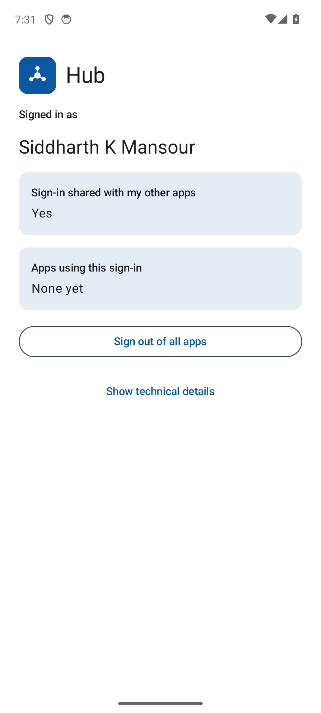
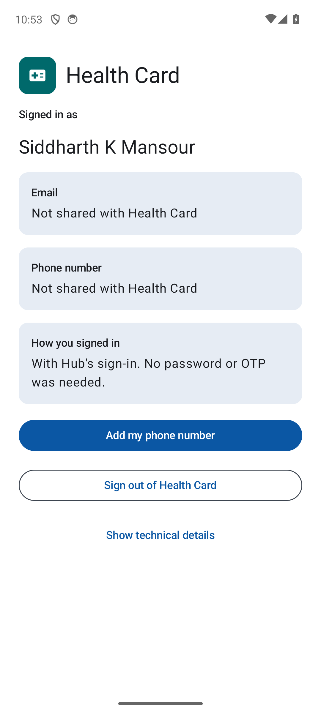
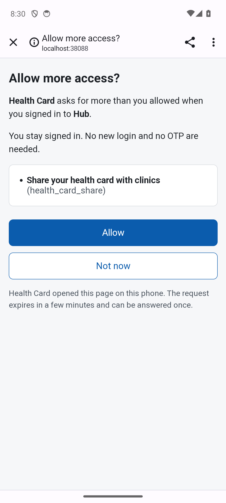
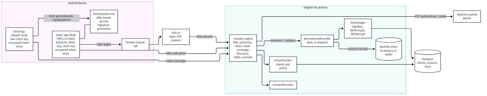

# Native SSO for mobile apps in eSignet (Go)

MOSIP Decode 2026, problem statement 03, team Badmosip.

This repository adds [OpenID Connect Native SSO for Mobile Apps 1.0](https://openid.net/specs/openid-connect-native-sso-1_0.html)
to eSignet Go and to the Thunder ID engine it runs on. A user signs in once, with an OTP, in one Android app (Hub).
A second Android app from the same publisher (Health Card) then signs the user in without a browser and without
a second OTP: it trades Hub's device secret for its own tokens at the token endpoint (OAuth 2.0 Token Exchange,
RFC 8693), proving possession of Hub's DPoP key (RFC 9449).

**Demo video:** https://youtu.be/KlTitpsxiIo

## Judge's path

1. See it: three screens below ([Screens](#screens)); every screen of both apps is in [docs/ux.md](docs/ux.md#screenshots).
2. Check each statement task (T1-T10, P1, P2, bonus B1) against its code and tests:
   [How each statement task is met](#how-each-statement-task-is-met).
3. Read the dated results: [docs/test-report.md](docs/test-report.md) (every automated check PASS; the three manual
   runs not done yet are listed with their reason).
4. Run it: [Try it in 10 minutes](#try-it-in-10-minutes).
5. Read the design: [docs/design.md](docs/design.md), [docs/threat-model.md](docs/threat-model.md),
   [docs/api.md](docs/api.md), Postman folder in [esignet/postman-collection/](esignet/postman-collection/README.md#native-sso).
6. See what the team changed in upstream code: `git diff c4c5443 -- thunder/` and `git diff 4eac1cc -- esignet/`;
   by task in [docs/changes.md](docs/changes.md).
7. Limits we state: [Known limits](#known-limits).

## Try it in 10 minutes

1. Start the server stack, run its 31 live tests and stop it again: `bash scripts/with-stack.sh bash e2e/run.sh`
   (needs Docker; expect `e2e: 31 passed, 0 failed`).
2. Build both apps: `( cd android && bash gradlew --no-daemon assembleDebug )` (needs JDK 17 and the Android SDK).
3. Start the stack, an emulator, both installed apps and Hub in front: `bash scripts/demo/demo.sh`.
   Without an emulator, `bash scripts/demo/demo.sh --no-emulator --check` runs the server part only.
4. In Hub, sign in with the OTP. Then open Health Card: it signs in on its own, with no OTP and no browser.
   Scene-by-scene steps and expected screens: [docs/demo-script.md](docs/demo-script.md).

Prerequisites and fixes: [docs/setup.md](docs/setup.md).

## Screens

| Hub, signed in | Health Card, signed in by Hub (no browser, no OTP) | eSignet's consent page, no login (bonus B1) |
|---|---|---|
|  |  |  |

Every screen of both apps, taken on the emulator by the UI tests: [docs/ux.md](docs/ux.md#screenshots).

## Test status

- **Built and tested**: every statement task (T1-T10, P1, P2) and the bonus B1, on the server and in both Android
  apps. Dated results of every check: [docs/test-report.md](docs/test-report.md).
  - Bonus B1 in full: when Health Card asks for a permission Hub's login did not include and that needs no new user
    data, the user approves it on eSignet's own consent page with no ID and no OTP (rule R28), and only with a cookie
    that eSignet set in the user's own browser login, so the app cannot approve for the user. Only new user data
    (the phone number) still needs a fresh login, because eSignet's identity system releases user data only after
    an authentication.
  - Server: 2465 Thunder (1 skipped by upstream) and 1613 eSignet unit tests, 0 failed, golangci-lint 0 findings in
    Thunder, eSignet and e2e; changed-line coverage 98.6 % (Thunder) and 91.7 % (eSignet); the live end-to-end suite
    (31 of 31 passed with the in-memory store and 31 of 31 with the Redis store, 2026-10-25, including device secret revocation
    with Health Card's tokens refused afterwards, R27, and consent-only re-consent, R28); the Postman folder under
    newman (40 requests, 146 assertions, 0 failed, including consent-only re-consent); govulncheck on eSignet: 0
    vulnerabilities in called code (2026-10-14 at `fd48556`).
  - Apps: 210 Android JVM tests, 0 failed (63 of them for Hub, rerun 2026-10-25); on the Android emulator the UI tests (6 of 6 passed, including the
    consent-only approval and refusal on eSignet's branded consent page, "Not now" on the consent screen and Health
    Card without Hub), the family sign-in tests (5 steps) and the full demo check (`bash scripts/demo/demo.sh --check`)
    passed. All on 2026-10-14 at `4c6e6cd` to `b580a4f`; trimmed logs in [docs/evidence/](docs/evidence/2026-10-14).
- **Hosted**: `main` on GitHub. The workflow `.github/workflows/ci.yml` passed every job (repo-lint, Go unit tests and
  golangci-lint for Thunder and eSignet, Android JVM tests and lint, the live e2e suite) on 2026-10-24 at
  `9bba2d7` ([run 40134113684](https://github.com/Paradox-73/Enable_Native_SSO_in_eSignet_Go_for_Mobile_Apps/actions/runs/40134113684)).
  Later commits run on GitHub when they are pushed; see the repository's Actions tab.
- **Optional**: eSignet's shipped `deployment.yaml` keeps Native SSO off (`native_sso.enabled: false`), so eSignet
  behaves as upstream; the local stack turns it on with `deploy/native-sso-demo.patch`.
- **Real phone**: on 2026-10-24 a OnePlus CPH2569 (Android 15) passed Hub sign-in and Health Card's silent sign-in, and a
  team member's TalkBack and large-font pass found no issues ([docs/evidence/2026-10-24/phone-run.md](docs/evidence/2026-10-24/phone-run.md)).
- **Not run**: the upstream Postman folders in the Postman desktop app (limit L07). Work packages and open decisions: [docs/changes.md](docs/changes.md#work-packages).
- **Video and manual checks**: [docs/video-script.md](docs/video-script.md), [docs/manual-test-checklist.md](docs/manual-test-checklist.md)
  (steps only a person can run: fresh clones on macOS, Linux and Windows, a real phone, TalkBack, a video dry run) and
  [docs/manual-test-results-template.md](docs/manual-test-results-template.md) to send the results back.

## What is here

| Part | Folder | What it holds |
|---|---|---|
| Thunder ID engine (upstream `thunder-id/thunderid` v1.0.1) with the Native SSO protocol rules | [thunder/](thunder/UPSTREAM.md) | scope handling, `device_sso` checks, `sid` and `ds_hash`, device secret at the code grant, token exchange with a device-secret actor token, scope rules, re-consent signal, discovery |
| eSignet Go (upstream `mosip/esignet` v2.0.0) | [esignet/](esignet/UPSTREAM.md) | the Device Secret Provider, Native SSO settings, token-exchange grant at client registration, userinfo limited to the granted scopes, API docs and Postman collection |
| Hub and Health Card (Kotlin, Android) | [android/](android/README.md) | Hub: sign-in, encrypted storage, family sign-in service. Health Card: silent sign-in, re-consent, sign-out. Shared libraries: OpenID Connect client, secure store, binder contract |
| Local stack (docker compose) | [deploy/](deploy/README.md) | eSignet built from this repository, Postgres, mock identity system, login pages |
| Live integration tests | [e2e/](e2e/client) | one Go test per server rule, run against the local stack |
| Documents | [docs/](docs/README.md) | design, threat model, API, test report, demo script, UX, slide outline, submission checklist |
| Scripts | [scripts/](scripts/README.md) | build, test, lint, demo, evidence, documentation checks |

Upstream code is imported unchanged in its own `import:` commit before any team change, so `git diff` against that
commit shows exactly what the team wrote. `bash scripts/verify-import.sh <thunder|esignet>` proves it byte for byte.
Sources, commits and licences: [THIRD_PARTY.md](THIRD_PARTY.md).

## Architecture



- Hub signs the user in with eSignet (PAR, PKCE, `private_key_jwt`, DPoP) and asks for the scope `device_sso`.
- Thunder, inside eSignet, sees `device_sso`, asks eSignet's Device Secret Provider for a device secret, adds `sid`
  and `ds_hash` to the id_token, and returns `device_secret` next to the tokens.
- Hub keeps tokens and device secret in a file encrypted with an Android Keystore key.
- Health Card binds to Hub's exported service. Hub checks the caller's signing certificate on every call and hands over
  the id_token, the device secret and DPoP proofs that it signs itself (it never gives away its key).
- Health Card sends a token exchange request to the token endpoint. Thunder checks the device secret through
  the provider, the id_token (`ds_hash`, `sid`, signature), the client's rights and the DPoP key, then issues tokens
  for Health Card.
- Asking for more scope than Hub's login had returns `interaction_required` (bonus B1). For a permission that needs
  no new user data the answer carries a `consent_uri`: the user taps "Allow" on eSignet's page, with no login, and
  Health Card repeats the exchange. For new user data (the phone number) Health Card runs its own login with consent.
- Flow diagrams: [user flow](docs/diagrams/user-flow.png), [Hub login](docs/diagrams/seq-super-app-login.png),
  [Child App sign-in](docs/diagrams/seq-child-app-sso.png), [consent-only re-consent](docs/diagrams/seq-consent-only.png),
  [re-consent with login](docs/diagrams/seq-reconsent.png),
  [exchange checks](docs/diagrams/exchange-validation.png). Full text: [docs/design.md](docs/design.md).

## Quick start

Tested on Windows 11 with Git Bash and Docker Desktop. The scripts need bash 4.4 or newer: on macOS, whose
`/bin/bash` is 3.2, run `brew install bash` first. Full steps, ports and fixes: [docs/setup.md](docs/setup.md).

```bash
git clone -c core.longpaths=true https://github.com/Paradox-73/Enable_Native_SSO_in_eSignet_Go_for_Mobile_Apps.git esignet-native-sso
cd esignet-native-sso
bash scripts/install-hooks.sh                         # local git settings
bash scripts/repo-lint.sh                             # repo-lint: OK

bash scripts/with-stack.sh bash e2e/run.sh            # stack up, 31 live tests, stack down: "e2e: 31 passed, 0 failed"
bash scripts/with-stack.sh bash esignet/postman-collection/native-sso/run.sh   # Postman folder under newman (needs newman)

bash scripts/demo/demo.sh --no-emulator --check       # server part of the demo: "demo ready (server part only ...)", "teardown ok"
bash scripts/demo/demo.sh                             # full demo with a visible emulator (see docs/demo-script.md)
```

- Needs Docker (Linux containers), JDK 17 or newer and the Android SDK for the apps and the demo, Node.js 20 or newer
  for the OpenAPI lint. Go runs in a container, so no local Go is needed.
- `bash make.sh help` lists these commands as short targets.

## How each statement task is met

Rule ids (R01-R28 server, A01-A13 apps) and their tests: [docs/design.md section 20](docs/design.md#20-rules-and-tests);
dated results: [docs/test-report.md](docs/test-report.md); every change with its commits: [docs/changes.md](docs/changes.md).
Test names below are Go unit tests (`go test -run`), live tests (`e2e/nativesso_test.go`) or Android tests.

| Task | What it asks | Code | Tests |
|---|---|---|---|
| P1 | Two apps signed with one certificate | [android/](android/README.md), `android/scripts/verify-family-signing.sh` | A01 |
| P2 | "Sign in with eSignet" per the RP guide | [HubAuthenticator.kt](android/superapp/src/main/java/org/badmosip/nativesso/superapp/auth/HubAuthenticator.kt), [oidc-client](android/oidc-client/src/main/kotlin/org/badmosip/nativesso/oidc/OidcClient.kt) | `HubAuthenticatorTest`, `HubScreensTest`; `SuperAppSignInTest` (emulator) |
| T1 | `device_sso` scope on the authorization request | [constants.go](thunder/backend/pkg/thunderidengine/providers/constants.go), [oauthutils.go](thunder/backend/internal/oauth/oauth2/utils/oauthutils.go), [deployment.yaml](esignet/esignet-service/data/deployment.yaml) | `TestE2E_Discovery_NativeSSO`, `TestE2E_SuperAppLogin_IssuesDeviceSecret` |
| T2 | Client must be allowed `device_sso` | [par/service.go](thunder/backend/internal/oauth/oauth2/par/service.go), [authz/service.go](thunder/backend/internal/oauth/oauth2/authz/service.go), [authorization_code_native_sso.go](thunder/backend/internal/oauth/oauth2/granthandlers/authorization_code_native_sso.go) | `TestE2E_DeviceSSO_ClientNotAllowed`, `TestDeviceSSO_ClientNotAllowedIsInvalidScope` |
| T3 | Device Secret Provider interface | [interface.go](thunder/backend/pkg/thunderidengine/providers/interface.go), [device_secret.go](thunder/backend/pkg/thunderidengine/providers/device_secret.go), `WithDeviceSecretProvider` in [engine.go](thunder/backend/pkg/thunderidengine/engine.go) | `TestDeviceSSO_WithoutProviderIsInvalidScope` (unit) |
| T4 | Generate and validate the device secret (signed, then encrypted JWT with `cnf.jkt`, `auth_id`, `exp`, ...) | [device_secret_provider.go](esignet/esignet-service/internal/engine/device_secret_provider.go) | `TestE2E_DeviceSecret_IsNestedJWE`, `TestDeviceSecretProviderTestSuite`; T4a ix: the id_token carries `sid` and `ds_hash` (left half of SHA-256 by default, the statement's full SHA-256 with `oauth.native_sso.ds_hash_full_sha256: true`): `TestDeviceSecretHash_FullSHA256`, `TestNativeSSO_HandleGrant_FullSHA256DSHash` |
| T5 | Call Generate at the token endpoint | [authorization_code_native_sso.go](thunder/backend/internal/oauth/oauth2/granthandlers/authorization_code_native_sso.go), [nativesso.go](thunder/backend/internal/oauth/oauth2/nativesso/nativesso.go) | `TestE2E_IDToken_HasSIDAndDSHash`, `TestDeviceSSO_ProviderFailureIssuesNoTokens` |
| T6 | Return `device_secret`; apps keep it encrypted | [token.go](thunder/backend/internal/oauth/oauth2/model/token.go), [EncryptedFileStore.kt](android/secure-store/src/main/java/org/badmosip/nativesso/securestore/EncryptedFileStore.kt) | `TestE2E_TokenResponse_Fields`, `EncryptedFileStoreTest` |
| T7 | App-to-app: second app gets id_token, device secret and a DPoP proof from the first | [IFamilySso.aidl](android/sso-contract/src/main/aidl/org/badmosip/nativesso/contract/IFamilySso.aidl), [FamilySsoService.kt](android/superapp/src/main/java/org/badmosip/nativesso/superapp/sso/FamilySsoService.kt), [HubConnection.kt](android/childapp/src/main/java/org/badmosip/nativesso/childapp/HubConnection.kt) | `FamilySsoGateTest`, `FamilySsoServiceTest`, `HubConnectionTest`; `FamilySsoBindTest` and `run-family-tests.sh` (emulator) |
| T8 | Second app calls token exchange, no `device_sso` | [CardAuthenticator.kt](android/childapp/src/main/java/org/badmosip/nativesso/childapp/auth/CardAuthenticator.kt) | `CardAuthenticatorTest`, `OidcClientTest` |
| T9 | Token exchange with the device-secret actor token, full validation | [token_exchange_native_sso.go](thunder/backend/internal/oauth/oauth2/granthandlers/token_exchange_native_sso.go) | 18 live tests `TestE2E_Exchange_*`, `TestTokenExchangeNativeSSOSuite` |
| T10 | Scope must be a subset; no `device_sso` in the exchange | same file | `TestE2E_Exchange_NarrowerScope`, `_ScopeSuperset`, `_DeviceSSOInScope` |
| B1 | Re-consent when the second app wants more scope | same file (`interaction_required`, `consent_uri`), [consent_page.go](thunder/backend/internal/oauth/oauth2/nativesso/consent_page.go), [CardController.kt](android/childapp/src/main/java/org/badmosip/nativesso/childapp/CardController.kt) | `TestE2E_Exchange_ScopeSuperset`, `TestE2E_Exchange_ConsentOnlyReconsent`, `CardControllerTest`; `ChildAppConsentOnlyTest`, `ChildAppReconsentTest` (emulator) |

## Deliverables

| Deliverable of the statement | Where |
|---|---|
| Native apps showing the full flow | [android/](android/README.md); run with [docs/demo-script.md](docs/demo-script.md); screenshots in [docs/ux.md](docs/ux.md#screenshots) |
| Updated Postman collection | [esignet/postman-collection/](esignet/postman-collection/README.md#native-sso), folder "Native SSO" |
| Updated API documentation | [docs/api.md](docs/api.md), [esignet-openapi.yaml](esignet/docs/esignet-openapi.yaml), [oauth2.yaml](thunder/api/oauth2.yaml) |
| Design document | [docs/design.md](docs/design.md), [docs/threat-model.md](docs/threat-model.md) |
| Presentation | slide deck, kept outside this repository and submitted with the other deliverables; outline in [docs/ppt-outline.md](docs/ppt-outline.md) |
| Demo video | script in [docs/video-script.md](docs/video-script.md); recording: https://youtu.be/KlTitpsxiIo |
| Submission items | [docs/submission-checklist.md](docs/submission-checklist.md) |

## Documents

[docs/README.md](docs/README.md) is the index. Short list: [setup](docs/setup.md), [test data](docs/test-data.md),
[API](docs/api.md), [changes and status](docs/changes.md), [UX and accessibility](docs/ux.md),
[test report](docs/test-report.md), [demo script](docs/demo-script.md), [upstream offers](docs/upstream-prs/thunder.md),
[contributing](CONTRIBUTING.md).

## Known limits

Full text with ids: [docs/test-report.md](docs/test-report.md#known-limits).

- **Silent sign-in lasts as long as Hub's device secret, 8 hours by default** (L10). Hub's home screen shows the end time
  and, once it has passed, tells the user to sign out and in again. Hub counts the 8 hours itself, because the device
  secret is encrypted for eSignet; a server with another lifetime makes that time wrong.
- Re-consent for new user data (the phone number) asks for the OTP again (L02); permissions that need no new user data
  are approved with no login (R28).
- The demo stack keeps eSignet's runtime store in memory (L03); several replicas need the Redis store
  (`PS03_RUNTIME_STORE=redis`, [deploy/README.md](deploy/README.md)), which passed the live suite.
- After sign-out (R27), a resource server that checks a token's signature without asking eSignet accepts it until it
  expires (L04).
- The stack is local, with the mock identity system, not the MOSIP Collab sandbox. The mentor call of 2026-09-30
  accepted a local mock server for judging; the sandbox cannot host a modified eSignet build.
- Software-backed Keystore on the emulator (L01); one emulator image (L06); one physical phone tried (L09).

## Team

Team **Badmosip**, MOSIP Decode 2026, problem statement 03. Each member's college ID proof is uploaded with the other
deliverables.

| Member | GitHub | Area |
|---|---|---|
| Kanav Bhardwaj | [Paradox-73](https://github.com/Paradox-73) | Thunder Native SSO engine |
| Ivan Bhargava | [Ivan825](https://github.com/Ivan825) | eSignet Device Secret Provider |
| Nikunj Mahajan | [nikunj169](https://github.com/nikunj169) | Hub Android app |
| Ishaan Sodhi | [aloofdevil](https://github.com/aloofdevil) | Health Card app and re-consent |
| Harsh Modi | [h4rshmodi007](https://github.com/h4rshmodi007) | local stack, end-to-end tests and documentation |

## Licence

Team code: MIT ([LICENSE](LICENSE)). Imported code keeps its own licence: Thunder Apache-2.0
(`thunder/LICENSE`), eSignet MPL-2.0 (`esignet/LICENSE`). See [THIRD_PARTY.md](THIRD_PARTY.md).
