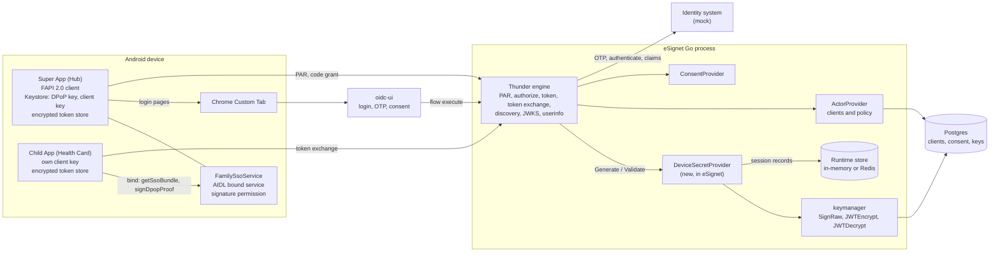
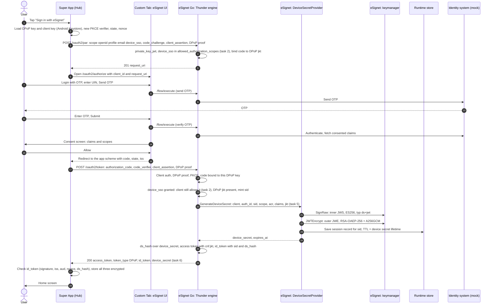
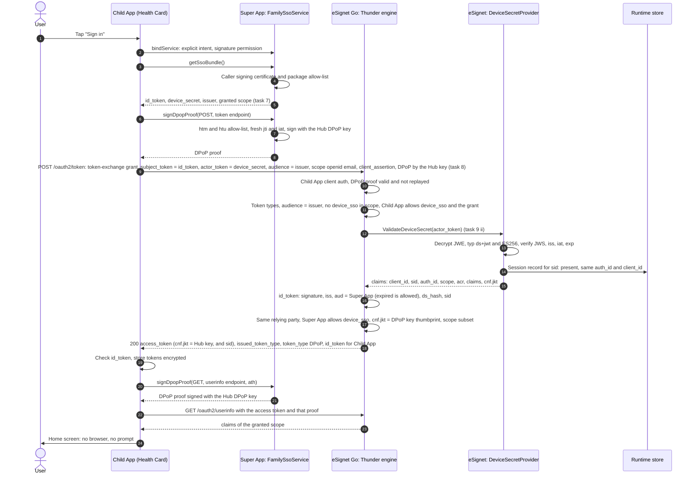
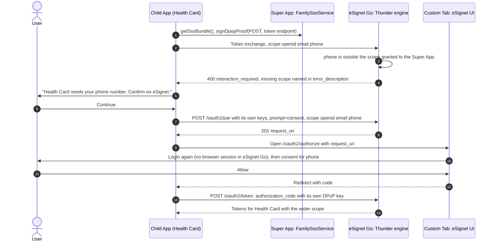
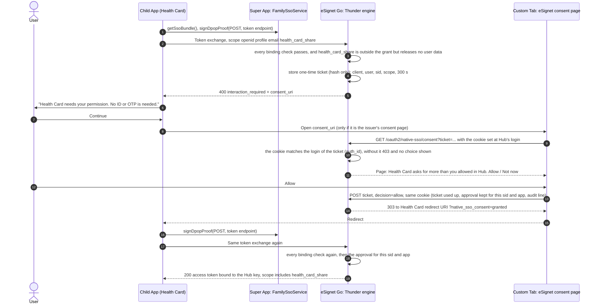
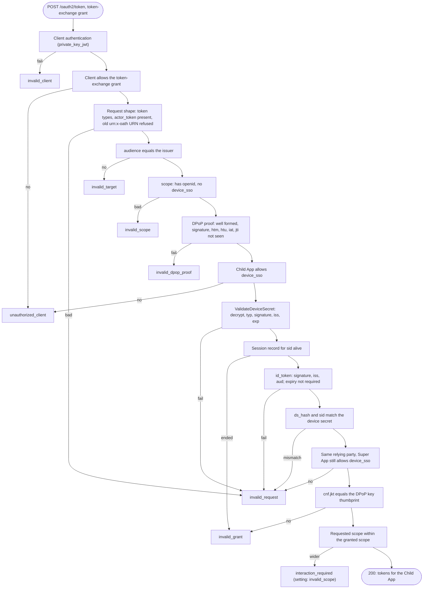

# Design: Native SSO for mobile apps in eSignet Go

- Problem statement 03 of MOSIP Decode 2026, team Badmosip.
- Status: **final for submission, 2026-10-05.** Written 2026-10-04 for the mentor call on Wed 2026-10-07, then
  re-checked against the built code on 2026-10-05: type, file, test and setting names below are the real ones.
  Every rule id (R01, A03, ...) names a test; dated results are in [test-report.md](test-report.md). Where the
  build differs from the first draft it is said in the text (sections 8, 14 and 20).
- Threats and their mitigations: [threat-model.md](threat-model.md). Diagram sources: [diagrams/](diagrams/).
- Upstream code is cited as `path:line` at the pinned commits (section [2](#2-context-esignet-go-and-thunder)).
  After import, eSignet files live under `esignet/` and Thunder files under `thunder/` in this repository.

## Contents

1. [Summary](#1-summary)
2. [Context: eSignet Go and Thunder](#2-context-esignet-go-and-thunder)
3. [Goals and non-goals](#3-goals-and-non-goals)
4. [Terms](#4-terms)
5. [Components and who owns what](#5-components-and-who-owns-what)
6. [Flows](#6-flows)
7. [Changes per codebase](#7-changes-per-codebase)
8. [Device Secret Provider contract](#8-device-secret-provider-contract)
9. [Device secret format](#9-device-secret-format)
10. [ds_hash and sid](#10-ds_hash-and-sid)
11. [Validation order at the token exchange](#11-validation-order-at-the-token-exchange)
12. [Scope rules and re-consent](#12-scope-rules-and-re-consent)
13. [Error table](#13-error-table)
14. [Configuration](#14-configuration)
15. [How the design uses the eSignet architecture](#15-how-the-design-uses-the-esignet-architecture)
16. [Decisions D1-D11](#16-decisions-d1-d11)
17. [Where the statement and the specifications differ](#17-where-the-statement-and-the-specifications-differ)
18. [Client keys on the phone and the RP integration guide](#18-client-keys-on-the-phone-and-the-rp-integration-guide)
19. [Statement task traceability](#19-statement-task-traceability)
20. [Rules and tests](#20-rules-and-tests)
21. [Future work](#21-future-work)
22. [References](#22-references)

## 1. Summary

- A user signs in once, with OTP and consent, in the **Super App**. A second app from the same vendor, the
  **Child App**, then signs in with no browser and no prompt.
- The standard is OpenID Connect Native SSO for Mobile Apps 1.0, draft 07 ("Native SSO" below):
  - the Super App asks for the extra scope `device_sso`;
  - the token endpoint returns a **device secret** next to the access token and id_token;
  - the id_token carries `ds_hash` (ties it to that device secret) and `sid` (the login session);
  - the Child App sends the id_token and the device secret to the token endpoint in an OAuth 2.0 Token Exchange
    request (RFC 8693) and receives its own tokens.
- Protocol rules go into the Thunder engine, which runs every OAuth endpoint inside eSignet Go. Keys, policy and
  the device secret itself go into eSignet, behind a new Thunder provider interface `DeviceSecretProvider`.
- Every token stays bound to the Super App's DPoP key (RFC 9449). That key lives in Android Keystore and cannot be
  exported, so a copied device secret is useless on another device or in another app.
- The Child App gets the id_token, the device secret and DPoP proofs from the Super App over an Android bound
  service that only apps signed with the same certificate may call.
- When the Child App asks for more than the Super App's login granted (bonus), eSignet refuses the exchange with
  `interaction_required`. If the extra scope needs no new user data (a permission), the answer carries a
  `consent_uri`: the user approves on eSignet's own page with no login, and the same exchange then succeeds.
  If it needs new user data (the phone number), the Child App runs its own login (section 6.3).

## 2. Context: eSignet Go and Thunder

- **eSignet Go** (`mosip/esignet`, v2.0.0, commit `db528423`) is MOSIP's OpenID Connect provider. Its
  [architecture document](https://github.com/mosip/esignet/blob/db528423dac7898ad546cb7b2f5f867a949676a7/docs/architecture.md)
  (sections 1 and 5) says protocol mechanics "live in the shared, external ThunderID engine"; eSignet contributes
  "MOSIP-specific providers, screen theming, and identity-backend integrations".
- **Thunder** (`thunder-id/thunderid`, v1.0.1, commit `12f517c4`) is that engine. eSignet pins exactly this commit
  (`esignet-service/go.mod:75`) and starts it with `thunderidengine.New(mux, opts...)`, passing 27 `With...`
  options, most of them providers (`esignet-service/cmd/esignet/main.go:150-178`).
- What exists today and is reused unchanged:
  - FAPI 2.0 pieces: PAR (`/oauth2/par`), PKCE, DPoP with code binding, `private_key_jwt`, per-client flags
    `require_pushed_authorization_requests`, `dpop_bound_access_tokens`, `require_pkce`
    (`esignet-service/internal/engine/actor_provider.go:28-30`);
  - a token-exchange grant handler in Thunder (`backend/internal/oauth/oauth2/granthandlers/token_exchange.go`);
  - DPoP proof checks with a `jti` replay store (`backend/internal/oauth/oauth2/dpop/verifier.go:65,107`) and the
    `cnf.jkt` comparison helper `dpop.VerifyProofBinding` (`dpop/util.go:82`);
  - eSignet's keymanager for signing and encryption (architecture section 2.4).
- What is missing for Native SSO (checked in the pinned code on 2026-10-04):
  - no `device_sso` scope, no device secret, no `device_secret` response field (`oauth2/model/token.go:31-39`);
  - no `sid` claim in Thunder v1.0.1 (Thunder `main` added one later, `constants.go:287-289` on `main`);
  - the device-secret token type is not accepted: unknown `actor_token_type` values are rejected
    (`token_exchange.go:97-101`);
  - the exchange ignores `audience` ("The RFC 8693 audience parameter is not honored", `token_exchange.go:257`)
    and silently drops requested scopes the subject token lacks (`token_exchange.go:486-496`);
  - Thunder's subject-token check rejects expired tokens (`tokenservice/validator.go:527-531`), while eSignet issues
    id_tokens with a 120 s lifetime (`esignet-service/data/deployment.yaml:119`);
  - eSignet client registration accepts only the `authorization_code` grant (`clientmgmt/validate.go:421-427`) and
    hands every client to Thunder with that grant only (`actor_provider.go:85`).
- Thunder's maintainers track the same feature as issue #3402 "App-native SSO" (open on 2026-10-04); their plan
  also uses the id_token as subject token and the device secret as actor token.

## 3. Goals and non-goals

Goals:
- Statement tasks 1-10 and the bonus, exactly as written, with every difference from the specifications
  explained (section [17](#17-where-the-statement-and-the-specifications-differ)).
- Changes that read like upstream wrote them: each codebase's own provider pattern, error types, configuration
  style, test style and lint rules, so the change can be offered upstream.
- Every rule tested twice, as a Go unit test and as a live test against the running stack, with negative cases.
- A device secret that carries no personal data, cannot be used without the Super App's key, and stops working
  when its server-side session record is gone.

Non-goals:
- iOS apps (the statement allows Android or iOS; one platform is enough to show the flow).
- Refresh tokens: eSignet allows only the `authorization_code` grant today (`deployment.yaml:136`), so no refresh
  token is issued by the code grant or the exchange; the Child App exchanges again when its access token expires.
- Server-side single logout. The specification defines no logout. The device secret itself can be revoked
  (section [6.4](#64-sign-out), rule R27), which also ends the access tokens the exchange issued from it; the
  Super App's own code-grant tokens are not revoked on the server.
- A generic token-exchange service. eSignet enables token exchange only for the Native SSO profile (D9).
- Device attestation (Play Integrity, key attestation): listed as future work.

## 4. Terms

| Term | Meaning |
|---|---|
| Super App ("Hub" in the demo) | The first Android app. The user signs in here once. |
| Child App ("Health Card" in the demo) | The second Android app from the same vendor, signed with the same certificate. |
| `device_sso` | Scope value that asks for Native SSO on the authorization request (Native SSO 3.1). |
| device secret | Token issued with the Super App's tokens; together with the id_token it lets a sibling app get its own tokens. Here a signed JWT inside an encrypted JWT. |
| `ds_hash` | id_token claim that binds the id_token to one device secret (Native SSO 3.4.1). |
| `sid` | id_token claim naming the login session (Native SSO 3.4.1). |
| DPoP | RFC 9449: the client signs a short proof for each request; tokens carry the key's thumbprint as `cnf.jkt`. |
| jkt | RFC 7638 SHA-256 thumbprint of a public key, base64url. |
| PAR, PKCE, `private_key_jwt` | RFC 9126 pushed authorization request; RFC 7636 code verifier; client authentication by a signed JWT (OIDC Core 9). |
| FAPI 2.0 | OpenID security profile that combines the three items above with sender-constrained tokens. |
| Provider | Thunder's plug-in pattern: a Go interface in `pkg/thunderidengine/providers`, passed in with a `With...Provider` option. |
| Relying party (RP) | The vendor organisation registered in eSignet (`relyingPartyId`); Thunder calls it the client's organisation unit (OU). |
| Runtime store | eSignet's store for short-lived state: in memory for local runs, Redis in production (architecture 2.8). |

## 5. Components and who owns what

<!-- source: diagrams/components.mmd -->


| Part | Owns | Does not own |
|---|---|---|
| Thunder engine | Protocol: the `device_sso` scope, the token endpoint, the device-secret branch of token exchange, id_token claims `sid` and `ds_hash`, discovery | Keys, device-secret format, session storage |
| eSignet | Policy and keys: client settings, the `DeviceSecretProvider` implementation (format, crypto, session records), configuration, client registration | Protocol order of checks |
| Super App | Login (FAPI 2.0), Keystore keys, encrypted storage of the three tokens, the family service that hands out the bundle and signs proofs | Any server decision |
| Child App | Asking the Super App, the token-exchange request with its own client authentication, re-consent | Any key of the Super App |

This split follows statement labels: tasks 3 and 9 are marked Thunder, tasks 1, 2, 4 and 6 eSignet, tasks 7 and 8
the client. Task 1 and 2 checks run in Thunder's request handling but read eSignet's client data, which is how
eSignet already feeds Thunder (`actor_provider.go:57-111`).

## 6. Flows

### 6.1 Super App sign-in and device secret issuance (statement diagram 1, journey steps 1-9)

<!-- source: diagrams/seq-super-app-login.mmd -->


Notes:
- The DPoP proof on the PAR request binds the authorization code to the key (RFC 9449 10.1); Thunder already
  checks it (`authz/requestvalidator/validator.go:90-94`). The same key signs every later proof.
- `device_sso` is checked twice: at PAR (RFC 9126 2.1 says the server validates the pushed request like an
  authorization request, including scope) and again at the token endpoint (task 2), because client settings can
  change between the two calls.
- The device secret and the id_token are issued both or neither (Native SSO 3.4): if the provider fails, the
  token endpoint answers `server_error` and issues nothing.
- The Thunder attribute cache that holds the released claims is extended to the device-secret lifetime
  (`attributecache.ExtendAttributeCacheTTL`, `backend/internal/attributecache/service.go:163`), so userinfo still
  works for the Child App's token later.

### 6.2 Child App silent sign-in (statement diagram 2, journey steps 10-11)

<!-- source: diagrams/seq-child-app-sso.mmd -->


The exchange request, in full:

```http
POST /oauth2/token HTTP/1.1
Content-Type: application/x-www-form-urlencoded
DPoP: <proof built and signed by the Super App, htm=POST, htu=<token endpoint>>

grant_type=urn:ietf:params:oauth:grant-type:token-exchange
&subject_token=<Super App id_token>
&subject_token_type=urn:ietf:params:oauth:token-type:id_token
&actor_token=<device secret>
&actor_token_type=urn:openid:params:token-type:device-secret
&audience=<issuer>
&scope=openid email
&client_id=<Child App client id>
&client_assertion_type=urn:ietf:params:oauth:client-assertion-type:jwt-bearer
&client_assertion=<JWT signed with the Child App's own Keystore key>
```

- `subject_token_type` uses the underscore form `id_token` from RFC 8693 3 and Thunder
  (`oauth2/constants/constants.go:148`). The Native SSO example writes `id-token`; Thunder would reject it.
- Response: `access_token`, `issued_token_type` = `urn:ietf:params:oauth:token-type:access_token`,
  `token_type` = `DPoP`, `expires_in`, `scope`, `id_token` (`aud` = Child App, same `sub`, same `sid`).
- The access token is bound to the Super App's key, the same `cnf.jkt` as the device secret (D3, statement sequence
  diagram 2), so the Child App asks the Super App for a proof for each userinfo call. The Super App signs only `POST`
  to its token endpoint and `GET` or `POST` to its userinfo endpoint, both exactly as discovered at its login.
- The new access token carries the same attribute-cache id (`aci`, `tokenservice/builder.go:189-190`) as the Super
  App's, so `/oauth2/userinfo` returns the claims the user released, limited to the Child App's scope.

### 6.3 Re-consent when the Child App asks for more (bonus)

<!-- source: diagrams/seq-reconsent.mmd -->


- Native SSO 4.3 step 6 and 4.4: when the requested scope needs consent, the server returns
  `interaction_required` and the client starts a normal browser authorization.
- eSignet Go keeps no browser login session (the embedded engine never starts Thunder's session package), so the
  user enters the OTP again. The app says so before opening the browser.
- This path is used only when the extra scope needs user data the login did not fetch (`phone` above). eSignet's
  identity system releases user data only in the KYC exchange that follows an authentication, so no consent
  screen alone can produce it. Everything else takes the consent-only path below.

#### Consent-only re-consent (rule R28)

<!-- source: diagrams/seq-consent-only.mmd -->


- When: every missing scope is allowed for the Child App, is not `openid` or `device_sso`, and releases no user
  claim outside the device secret's `claims` (what the login already released). A permission scope such as
  `health_card_share` qualifies; `phone` after a login without it does not. Setting:
  `oauth.native_sso.consent_only_reconsent` (on in eSignet's `deployment.yaml`).
- The answer stays `interaction_required` (Native SSO 4.4 "MUST return"); `consent_uri` and `consent_expires_in` are
  extra members a client that does not know them ignores, so older apps fall back to the own login.
- Who answers the page: the person in the browser where the Super App's login happened, not the Child App. The
  ticket in `consent_uri` goes to the Child App, which could read it and post "Allow" itself, so the ticket alone is
  not enough. When the browser opens `/oauth2/authorize` for a login with `device_sso`, Thunder sets an `HttpOnly`,
  `SameSite=Lax` cookie `tid_nsso` (`Secure` behind TLS) whose path is the consent page only, under the path of the
  public base URL (so `/v1/esignet/oauth2/native-sso/consent` behind a proxy that publishes eSignet at
  `/v1/esignet`), and keeps a SHA-256 hash of its 256-bit value under the login's `auth_id` for the device secret
  lifetime (`nativesso/consent_browser.go`). A browser holds one such cookie: a later `device_sso` login in it
  replaces the cookie, and the consent pages of the earlier login then answer 403. The ticket carries the `auth_id` of the device secret, and the page shows
  the choice and records an answer only with the matching cookie. The Child App's own HTTP client and its web views
  have their own cookie stores; a Custom Tab shares the browser's, so the user sees the page and taps. Without
  the cookie the page answers 403, shows no buttons, writes an audit line and leaves the ticket for the user. A
  form must also carry `Origin` (or `Sec-Fetch-Site: same-origin`).
- The ticket was issued only to a client that authenticated with `private_key_jwt` and presented the device
  secret, the matching id_token and a proof from the Super App's DPoP key. It is 256 random bits, stored only as a
  hash, bound to the client, user, `sid`, `auth_id` and scope list, valid for at most 300 s (never past the device
  secret) and used up by the first answer.
- What "Allow" records: an approval for that Child App, that user and that login session (`sid`), until the device
  secret expires. The approval is read only by a later token exchange that passes every binding check again, so a
  leaked ticket or a forged redirect yields no token. A new login asks again; revoking the device secret (R27) ends
  the session, so the exchange fails with `invalid_grant` before the approval is read; removing the scope from the
  client stops it at the next exchange.
- The page: client names from eSignet's client registry, the scopes and their claims, "Allow" and "Not now"; no
  script; `X-Frame-Options: DENY` and `frame-ancestors 'none'` against clickjacking; `no-store`; `Referrer-Policy: same-origin` (the
  URL holds the ticket); `form-action` only to the server and the app's registered redirect URI; a form from another
  origin is refused. The answer is a 303 to the app's single registered redirect URI with
  `native_sso_consent=granted` or `denied`; the app checks that `consent_uri` is the issuer's consent page before it
  opens it.
- Audit: one log line per ticket issued, granted, denied and answered outside the login browser (client ids,
  scopes, a hash of the `sid`; no user data,
  `sid` or ticket). eSignet's consent records are not written: `ConsentProvider.RecordConsent` reads the
  authorization request of a running flow and would replace the record of the Child App's own browser login.
- Tokens: the same as any exchange (D3): bound to the Super App's key, `sid` of the login, claims limited as in
  section 12.

### 6.4 Sign-out

- Super App "Sign out of all apps": deletes its tokens, the device secret and its DPoP key from Android Keystore.
  Every device secret and every Child App token is bound to that key (`cnf.jkt`), so all of them become unusable
  at once, with no server call.
- The Child App then finds no bundle at the Super App, clears its own tokens and shows "Sign in to Hub first".
- On the server the Super App revokes its device secret at the RFC 7009 endpoint, `POST /oauth2/revoke` with
  `token_type_hint=device_secret` and its own `private_key_jwt` (rule R27). It does this right after the local
  sign-out: the request needs only the client key, not the deleted DPoP key, and the user is signed out on the
  phone even when the call fails (`HubAuthenticator.signOut`). Thunder
  validates the value through the Device Secret Provider, checks that it was issued to the calling client (another
  app of the vendor gets `invalid_grant`), and calls `EndDeviceSecretSession`; eSignet deletes the session record.
  Every later exchange with that device secret is `invalid_grant` (session ended). The endpoint exists whenever the
  engine has a provider, also with eSignet's deny-list revocation (`oauth.token_revocation`) off; other tokens then
  get `unsupported_token_type`. If the call fails (no network), the record still ends by its TTL and the deleted
  DPoP key already blocks every use.
- Child App access tokens issued earlier stop working at the same moment. The exchange writes the login's `sid`
  into each access token it issues, and Thunder's token validation (`ValidateAccessToken`, used by userinfo,
  introspection and every other engine endpoint that takes an access token) asks the Device Secret Provider
  whether that session is still active (`IsDeviceSecretSessionActive`; eSignet looks for the session record). An
  ended session answers like a revoked token (`401 invalid_token` at userinfo, `active: false` at
  introspection); a session store that cannot answer refuses the token (fail closed). No deny list is needed.
  Limits: a resource server that checks the JWT itself, without introspection, still accepts the token until its
  `exp`, and the Super App's own code-grant access token carries no `sid`, so it lives until its `exp` (the Super
  App has already deleted it).

Overview of the whole journey: [diagrams/user-flow.mmd](diagrams/user-flow.mmd).

## 7. Changes per codebase

Thunder (`thunder/backend`, Apache-2.0 header on new files):

| Change | Where | Follows the upstream pattern of |
|---|---|---|
| `DeviceSecretProvider` interface and request/claims types | `pkg/thunderidengine/providers/interface.go`, `device_secret.go`, `constants.go` | `ConsentProvider` (`interface.go:135`) |
| `WithDeviceSecretProvider` option; feature off when no provider is passed | `pkg/thunderidengine/engine.go` | `WithConsentProvider` (`engine.go:516`) |
| `device_sso` scope constant, kept with the OpenID scopes by `SeparateOIDCAndNonOIDCScopes`; not added to `StandardOIDCScopes` (that list is seeded into every client) | `internal/oauth/oauth2/constants`, `utils/oauthutils.go:146-161` | existing scope constants |
| `device_sso` allowed-scope check at PAR, authorize and the code grant | `par/`, `authz/`, `granthandlers/authorization_code.go` | `invalid_scope` responses in the same files |
| Mint `sid`, call `GenerateDeviceSecret`, compute `ds_hash`, return `device_secret` | `granthandlers/authorization_code.go`, `tokenservice/builder.go`, `model/token.go` | `at_hash`-style claims in `buildIDTokenClaims` |
| Device-secret branch in token exchange: token type constant, provider validation, id_token checks, `audience`, scope rules | `granthandlers/token_exchange.go` (+ a new `token_exchange_native_sso.go`) | the ID-JAG branch (`token_exchange.go:145-150`) |
| Discovery: `native_sso_supported`, `device_sso` in `scopes_supported` | `discovery/service.go` | existing metadata fields |
| Consent-only re-consent: `consent_uri` on `interaction_required`, consent page, one-time tickets and per-session approvals in the runtime store, audit lines | `granthandlers/token_exchange_native_sso.go`, `nativesso/consent_*.go`, `model/error.go`, `token/handler.go`, `authz/handler.go` (marks the login browser), `init.go` | PAR's runtime-store `request_uri`; the authorize endpoint's route registration |
| Settings `oauth.native_sso.*` | `engineconfig.OAuthConfig` | other `oauth.*` groups |
| Mocks rebuilt by mockery v3.5.5 from `.mockery.public.yml` and `.mockery.private.yml` | `tests/mocks/...` | upstream `make mockery` |

eSignet (`esignet/esignet-service`, MPL-2.0 header on new files):

| Change | Where | Follows the upstream pattern of |
|---|---|---|
| `NewDeviceSecretProvider(cfg, signatureSvc, cryptoSvc, runtimeStore, clock)` | `internal/engine/device_secret_provider.go` | other providers in `internal/engine` |
| Wire the provider; provision the `DEVICE_SECRET` encryption key at start-up | `cmd/esignet/main.go` (`provisionKeyHierarchy`, `main.go:346`) | existing key provisioning |
| `native_sso` settings and `MOSIP_ESIGNET_NATIVE_SSO_*` overrides | `internal/config/app.go`, `data/deployment.yaml` | existing `MOSIP_ESIGNET_*` overrides |
| Accept the token-exchange grant at client registration and pass the client's grants to Thunder | `internal/clientmgmt/validate.go:421-427`, `internal/engine/actor_provider.go:85` | existing grant validation |
| Docs: settings, API | `esignet/docs/configuration.md`, `esignet/docs/esignet-openapi.yaml`, Postman "Native SSO" folder | upstream docs |

`device_sso` must never be added to eSignet's `scope_claims` setting: `getAllowedScopes` copies every `scope_claims`
key into every client's allowed scopes (`actor_provider.go:274-285`), which would make the task 2 and task 9 checks
pass for every client. The checks read the client's `allowed_authorization_scopes` only.

## 8. Device Secret Provider contract

Go interface in Thunder (`pkg/thunderidengine/providers/interface.go`; the request, secret and claims types are in `device_secret.go`, the shared constants in `constants.go`):

```go
// DeviceSecretProvider issues and checks device secrets for
// OpenID Connect Native SSO for Mobile Apps 1.0 (draft 07).
type DeviceSecretProvider interface {
	// GenerateDeviceSecret returns a new device secret for an authorization-code grant
	// that was granted the device_sso scope.
	GenerateDeviceSecret(ctx context.Context, req DeviceSecretRequest) (*DeviceSecret, *common.ServiceError)
	// ValidateDeviceSecret checks a device secret presented as actor_token and returns its
	// claims when it is authentic, unexpired and its login session is still active.
	ValidateDeviceSecret(ctx context.Context, deviceSecret string) (*DeviceSecretClaims, *common.ServiceError)
	// EndDeviceSecretSession ends the login session of a device secret (RFC 7009 revocation, R27).
	EndDeviceSecretSession(ctx context.Context, claims *DeviceSecretClaims) *common.ServiceError
	// IsDeviceSecretSessionActive reports whether a sid's session is still active (tokens carrying it, R27).
	IsDeviceSecretSessionActive(ctx context.Context, sessionID string) (bool, *common.ServiceError)
	// RecordConsentReuse records a token exchange that reused the login's consent with no consent
	// screen (statement diagram 2, R29); an error fails the exchange with server_error.
	RecordConsentReuse(ctx context.Context, reuse ConsentReuse) *common.ServiceError
}
```

| Type | Fields |
|---|---|
| `DeviceSecretRequest` | `ClientID`, `OUID`, `Subject`, `AuthID`, `SessionID`, `Scopes`, `ACR`, `Claims`, `AuthTime`, `DPoPJkt`, `AttributeCacheID` |
| `DeviceSecret` | `Value` (compact JWE, opaque to clients), `ExpiresAt` |
| `DeviceSecretClaims` | the request fields plus `Issuer`, `IssuedAt`, `ExpiresAt` |
| `ConsentReuse` | `ClientID` (the second app), `Device` (the validated device secret claims), `Scopes` (issued), `Claims` (released claim names) |

Contract rules:
- Thunder treats the device secret as an opaque string. Only the provider knows its format (Native SSO 3.2:
  "The exact construction of the device_secret is out of scope").
- `ValidateDeviceSecret` returns one of four outcomes: valid claims; `ErrorInvalidDeviceSecret` (malformed,
  forged, expired, wrong type or issuer), which Thunder maps to `invalid_request`; `ErrorDeviceSecretSessionEnded`
  (genuine, but its login session has ended), which Thunder maps to `invalid_grant` (Native SSO 4.3 step 4); or a
  server error. Errors are `*common.ServiceError`, as for every other provider.
- Any `GenerateDeviceSecret` error becomes `server_error` with no tokens (both or neither, Native SSO 3.4).
- Shared names live in `providers/constants.go`: `ScopeDeviceSSO` (`device_sso`), `TokenTypeDeviceSecret`
  (`urn:openid:params:token-type:device-secret`) and the runtime-store namespace `NamespaceNativeSSOSession`
  (`nativesso:session`).
- The provider never logs the device secret, the user id or claim values (Thunder rule: no personal data in logs).
- No provider passed means no Native SSO: `device_sso` is not advertised and is rejected like any unknown scope,
  and the device-secret token type is refused (R03).
- Thunder main already names the session claim `ClaimSessionID = "sid"`; the same name is used so a later rebase
  onto main stays small.

## 9. Device secret format

A nested JWT: signed first, then encrypted (statement task 6; RFC 7519 11.2; OIDC Core 16.14).

| Layer | Value | Built by |
|---|---|---|
| Outer JWE header | `alg` RSA-OAEP-256, `enc` A256GCM, `cty` JWT, `kid` of the encryption key | `cryptomanager.Service.JWTEncrypt` (`internal/keymanager/cryptomanager/service.go:295`, `jwe.go:25`) |
| Inner JWS header | `alg` ES256, `typ` `ds+jwt`, `kid` of the signing key | provider, signed with `signature.Service.SignRaw` (`internal/keymanager/signature/service.go:387`) |
| Inner claims | see the next table | provider |

Inner claims (statement task 4a items i-viii, plus three standard claims):

| Claim | Task 4a | Value |
|---|---|---|
| `cnf.jkt` | i | RFC 7638 thumbprint of the Super App's DPoP key, from the code grant's verified proof |
| `auth_id` | ii | id of the authorization request of the original login, carried onto the code record (our reading; mentor question 5) |
| `exp` | iii | issue time + `device_secret_validity_seconds` (proposal: 8 hours) |
| `client_id` | iv | Super App client id |
| `scope` | v | scope granted to the Super App, without `device_sso` |
| `acr` | vi | authentication context of the login, for example `mosip:idp:acr:generated-code` |
| `claims` | vii | names (not values) of the user claims released to the Super App |
| `iss` | viii | eSignet issuer URL |
| `sid` | - | login session id, also in the id_token (section [10](#10-ds_hash-and-sid)) |
| `iat`, `jti` | - | issue time and a unique id (RFC 7519) |

Why this shape:
- **Encrypted**: Native SSO 3.2 says the server "MUST adequately protect the value such as using a JWE if the AS
  is not maintaining state", and 6.1 says it "SHOULD be encrypted". The claims (`scope`, `claims`, `acr`) would
  otherwise be readable by any app that holds the secret.
- **Explicit `typ` and dedicated keys**: RFC 8725 3.11 and 3.12. An id_token or access token pasted in as a device
  secret fails the type check and decrypts with no key (R09). Engine tokens are signed with the `RSA_2048` key by
  default (`internal/config/app.go:344`); the device secret uses the `EC_SECP256R1_SIGN` key. Start-up fails if a
  deployment points both at the same key.
- **Why `SignRaw` and not `JWSSign`**: `JWSSign` builds a header with only `alg`, `kid` and certificate fields
  (`signature/service.go:190`), so it cannot carry `typ`. `VerifyRaw` (`:451`) checks the result.
- **No personal data inside**: user id and attribute values stay in the session record on the server, so a leaked
  device secret reveals no PII and is useless once the record is gone.
- **Keys from eSignet's keymanager** (architecture 2.4): the encryption key is a database key under the
  `OIDC_SERVICE` master key, reference id `DEVICE_SECRET`, created by `keymanager.Service.GetCertificate`
  (`internal/keymanager/service.go:731`). `JWTDecrypt` finds the key by the JWE `kid`, so device secrets issued
  before a key rotation keep working until that key is revoked. `JWTDecrypt` refuses keys held only in the
  PKCS#11/PKCS#12 keystore (`cryptomanager/keyresolve.go:22`); the master key that wraps the encryption key does
  live there.

Session record (runtime store, namespace `nativesso:session`, key `sid`):

| Field | Use |
|---|---|
| `auth_id`, `client_id` | must equal the device secret's claims |
| `subject`, `ou_id` | user (PSUT) and relying party of the Super App, for the Child App's tokens and the same-vendor rule |
| `attribute_cache_id` | where the released claims are cached, for userinfo |
| `expires_at` | TTL of the record = device secret lifetime |

- Lifetime: the device secret's `exp`, the session record TTL and the cached user attributes all follow
  `device_secret_validity_seconds`.
- In memory locally, Redis in production (architecture 2.8), so every replica sees the same sessions.

## 10. ds_hash and sid

- `ds_hash` = base64url (no padding) of the left-most 128 bits of SHA-256 over the ASCII bytes of the device
  secret, the same construction as OIDC Core's `at_hash` (OIDC Core 3.1.3.6).
  - Native SSO 3.4.1 leaves the binding to the server but says `ds_hash` "MUST NOT leak any data". A truncated hash
    of an encrypted value leaks nothing.
  - The Super App can check it too, so a device secret swapped in storage is noticed on the device.
- `sid` = 128 random bits, base64url (22 characters), minted at the code grant. It is in the id_token, in the
  device secret and is the key of the session record. The Child App's id_token carries the same `sid`, so both
  apps share one login session.
- This is the statement's "device_secret must be embedded into the id_token" (task 4a ix) read through the
  specification; see D2.

Note on task 4a ix. The statement says "The device_secret must be embedded into the id_token". The id_token carries
`ds_hash` and `sid`, as OpenID Connect Native SSO 1.0 section 3.4.1 defines, and the device secret travels only in
the `device_secret` field of the token response.
- Why: an id_token is passed to relying parties and read by any party that sees it; the device secret is the
  credential for token exchange and never leaves the token response. `ds_hash` lets the id_token prove which device
  secret it belongs to without exposing it.
- Formula: diagram 1 of the statement shows `ds_hash = BASE64URL(SHA-256(device_secret))`. We use the left-most 128
  bits of the SHA-256 hash, base64url encoded, the `at_hash` construction of OIDC Core 3.1.3.6. Native SSO 3.4.1 does
  not fix the formula ("The exact binding between the ds_hash and device_secret is not specified by this profile").
  The diagram's formula is available as an opt-in setting: `oauth.native_sso.ds_hash_full_sha256: true`
  (`MOSIP_ESIGNET_NATIVE_SSO_DS_HASH_FULL_SHA256`) makes Thunder put the full 43-character
  `BASE64URL(SHA-256(device_secret))` in the id_token and check that form in the exchange. The default stays the
  `at_hash` form, which Hub (`IdTokenValidator`'s `dsHash` parameter) and the e2e suite check; a deployment that turns
  the setting on must give its apps the same rule.

## 11. Validation order at the token exchange

The order keeps Thunder's existing token pipeline (`token/service.go:64-262`: client authentication, grant
allowed, request shape, DPoP proof, then the grant handler) and, inside the grant handler, the order of
Native SSO 4.3 ("MUST perform ... before issuing any tokens"). Cheap request checks run before any decryption, so
a malformed or unauthenticated request never reaches the provider. Any failure stops processing; no tokens are
issued.

<!-- source: diagrams/exchange-validation.mmd -->


Before the grant handler (Thunder's token service; steps 1, 2 and 5 exist today):

1. Client authentication of the **Child App** with its own `private_key_jwt` (Native SSO 4.1: "Confidential
   clients MUST use client authentication"). Else `invalid_client`.
2. The Child App may use the token-exchange grant (`IsAllowedGrantType`, `token/service.go:120`). Else
   `unauthorized_client`.
3. Request shape, in the handler's `ValidateGrant` (RFC 8693 2.1): `subject_token_type` is the id_token type,
   `actor_token` is present and `actor_token_type` is `urn:openid:params:token-type:device-secret` (task 9 i).
   The draft-06 URN `urn:x-oath:params:oauth:token-type:device-secret` gets `invalid_request` with a message naming
   the new URN (R10). A device-secret actor token selects the Native SSO branch, the way a requested ID-JAG token
   selects its branch today (`token_exchange.go:145-150`).
4. In the same step: `audience` equals the issuer (Native SSO 4.1), else `invalid_target` (R18); `scope` contains
   `openid` (Native SSO 4.1) and not `device_sso` (task 10b), else `invalid_scope` (R16).
5. DPoP proof (`token/service.go:266-280`): required for DPoP-bound clients, `htm`/`htu`/`iat` checked, `jti`
   recorded against replay. Else `invalid_dpop_proof` (R14, R22).

In the Native SSO branch of the token-exchange handler:

6. The Child App has `device_sso` in its `allowed_authorization_scopes` (task 9 iii.3). Else
   `unauthorized_client` (R13).
7. `ValidateDeviceSecret` (task 9 ii): decrypt the JWE; the inner header must be `typ` `ds+jwt` and `alg` ES256;
   verify the signature; `iss`, `iat`, `exp`. RFC 8725 3.3: both layers are validated. Else `invalid_request` (R09).
8. Session record for the device secret's `sid` exists and matches its `auth_id` and `client_id` (task 9 iii.2).
   A missing record is an ended session: `invalid_grant` (R12).
9. id_token (task 9 iii): signature by this server's key from its own JWKS, `iss` equal to the issuer, `aud`
   equal to the device secret's `client_id`. **Expiry is not required**: see the next subsection (R20, R21).
10. `ds_hash` in the id_token equals the hash of the presented device secret (task 9 iii.1, R11), and the
    id_token's `sid` equals the device secret's `sid` (task 9 iii.2, R12). Mismatch: `invalid_request`.
    Only then the optional cap `id_token_max_age_seconds` (off by default, D8) rejects an id_token older than the cap
    with `invalid_grant`, as for an ended session (R21). The order matters: an old id_token paired with the wrong
    device secret gets the mismatch error, not "sign in again".
11. Same vendor: the Child App and the Super App named in the device secret belong to the same relying party, and
    the Super App still allows `device_sso` (Native SSO 4.3 step 5, task 9 iii.3; D7). Else `invalid_request` (R19).
12. The device secret's `cnf.jkt` equals the thumbprint of the key in this request's DPoP proof (task 9 iii.4),
    checked with Thunder's existing `dpop.VerifyProofBinding`, which answers `invalid_grant` (R14).
13. Scope rules (task 10a): section [12](#12-scope-rules-and-re-consent).
14. Issue tokens for the Child App: access token bound to the same `cnf.jkt` as the device secret (the key step 12
    proved), `aud` and `client_id` of the Child App, same `sub`, same attribute-cache id, the login's `sid`; id_token
    with `aud` = Child App, same `sub`, same `sid` (R23).
15. Record the silent consent reuse (statement diagram 2): one audit line `native_sso_consent_reused` (apps, scopes,
    a hash of the session, never the user) and one `consent_history` row in eSignet's database for the Child App,
    written by the device secret provider. The row holds the issued scopes, the released claim names and the
    device secret's expiry; `consent_detail` is not changed, so a later browser login of the Child App still asks
    for consent. If the row cannot be written the exchange fails with `server_error` and no token leaves (R29).
    The row is written per issued exchange, not per consent decision: a Child App that renews its 120 s access
    token by exchange adds one row each time, up to about 240 rows per app and login over the device secret's
    8 hours. Upstream eSignet writes `consent_history` only when a consent changes; a deployment that keeps these
    rows sets a retention rule for them (future work, section 21).

### 11.1 Why an expired id_token is accepted

- eSignet signs every engine JWT, id_tokens included, with a 120 s lifetime (`deployment.yaml:119`, no separate
  id_token lifetime in `actor_provider.go:335-358`). A user who opens the Child App more than two minutes after
  signing in to the Super App, which is the normal case, presents an expired id_token.
- Native SSO 6.3 expects this: the id_token "may have expired at the time of use".
- In this profile the id_token is not a credential on its own. It is accepted only together with a device secret
  that is unexpired, encrypted and signed by eSignet, bound to it by `ds_hash`, tied to a live session record by
  `sid`, and usable only with a proof from the Super App's non-exportable DPoP key (`cnf.jkt`). Those checks
  decide how long silent sign-in works; the id_token's `exp` does not.
- The threat model covers this in detail: [threat-model.md](threat-model.md#5-why-accepting-an-expired-id_token-is-safe).

## 12. Scope rules and re-consent

| Request from the Child App | Result | Statement / spec | Rule |
|---|---|---|---|
| `scope` equal to or narrower than the Super App's granted scope | 200, `scope` in the response is what was issued | task 10a ("the reverse ... is allowed") | R17 |
| `scope` with any value outside the granted scope | `interaction_required` (default) or `invalid_scope` (setting) | task 10a "must fail"; Native SSO 4.3 step 6, 4.4; bonus | R15 |
| the same, when every outside value needs consent only (no new user data) | `interaction_required` with `consent_uri`; after "Allow" on that page, 200 for that login session | bonus; section [6.3](#63-re-consent-when-the-child-app-asks-for-more-bonus) | R28 |
| `scope` containing `device_sso` | `invalid_scope` | task 10b | R16 |
| `scope` without `openid` | `invalid_scope` | Native SSO 4.1 | R16 |
| no `scope` | the Super App's granted scope | RFC 8693 2.1 (scope optional) | R17 |

- Thunder today drops unknown scopes silently (`token_exchange.go:486-496`). For the Native SSO branch this becomes
  a hard failure; other token-exchange users keep today's behaviour.
- `interaction_required` is the default because Native SSO 4.4 says the server "MUST return" it when user
  interaction is needed; it still makes the exchange fail as task 10a asks, and it is the signal the Child App uses
  to start re-consent (bonus). A deployment that wants the plain task 10a error sets
  `scope_exceeded_error: invalid_scope`.
- The `error_description` names the missing scope values only (no user data), so the Child App can tell the user
  which permission it needs.

## 13. Error table

All errors use Thunder's `model.ErrorResponse` (HTTP 400 unless noted) and the codes the specifications name.

| Situation | `error` | Basis | Rule |
|---|---|---|---|
| `device_sso` requested by a client not allowed it (PAR, authorize, code grant) | `invalid_scope` | task 2, RFC 9126 2.1 | R02 |
| `device_sso` code grant without a DPoP proof, client not registered as DPoP-bound (no key to bind) | `invalid_request` | task 4a `cnf.jkt` | R07 |
| Any token request without a DPoP proof from a DPoP-bound client (both demo apps) | `invalid_dpop_proof` | existing check, `token/service.go:266-280` | R07, R14 |
| Device secret generation fails | `server_error` (500), no tokens | Native SSO 3.4: both or neither | R08 |
| Malformed exchange: token types, missing `actor_token`, old `urn:x-oath:` URN | `invalid_request` | RFC 8693 2.2.2 | R10 |
| Device secret invalid or expired; id_token signature or issuer; `ds_hash` or `sid` mismatch; other vendor | `invalid_request` | RFC 8693 2.2.2 ("invalid ... or unacceptable based on policy") | R09, R11, R12, R19, R20 |
| Login session ended (no session record for `sid`); id_token older than `id_token_max_age_seconds` | `invalid_grant` | Native SSO 4.3 step 4; the same remedy, a new login of the Super App, which the Child App tells the user. RFC 8693 2.2.2 would answer a subject_token "unacceptable based on policy" with `invalid_request`; for the age cap this profile follows the Native SSO session rule instead, because only a new Super App login helps | R12, R21 |
| DPoP key differs from `cnf.jkt` | `invalid_grant` | existing `dpop.VerifyProofBinding` | R14 |
| DPoP proof malformed or replayed | `invalid_dpop_proof` | RFC 9449 5, 11.1 | R22 |
| `audience` is not the issuer | `invalid_target` | RFC 8693 2.2.2, Native SSO 4.1 | R18 |
| Requesting client lacks `device_sso` or the token-exchange grant | `unauthorized_client` | task 9 iii.3, RFC 6749 5.2 | R13 |
| `device_sso` in the exchange scope; scope without `openid` | `invalid_scope` | task 10b, Native SSO 4.1 | R16 |
| Scope beyond the original grant | `interaction_required` (setting: `invalid_scope`) | Native SSO 4.3 step 6, task 10a, bonus | R15 |
| Same, consent only needed | `interaction_required` with `consent_uri` and `consent_expires_in` | bonus | R28 |
| Any other token exchange while eSignet allows only Native SSO | `invalid_request` | D9 | R26 |

Where RFC 8693 and Native SSO disagree (RFC 8693: invalid tokens give `invalid_request`; Native SSO: a dead session
gives `invalid_grant`), the more specific profile wins for the session case only.

## 14. Configuration

Server settings in eSignet's `data/deployment.yaml` (precedence: environment variable, then yaml, then default, as
for every eSignet setting, architecture 2.8):

| Key | Variable | Default | Meaning |
|---|---|---|---|
| `oauth.allowed_scopes` | (yaml) | adds `device_sso` | advertised in discovery |
| `oauth.allowed_grant_types` | (yaml) | adds `urn:ietf:params:oauth:grant-type:token-exchange` | Thunder builds the handler only for listed grants |
| `native_sso.enabled` | `MOSIP_ESIGNET_NATIVE_SSO_ENABLED` | false (opt-in), also in the shipped `deployment.yaml`; true for the local stack (`deploy/native-sso-demo.patch`) | off: no device secret provider is passed to the engine, so `device_sso` is refused, and no userinfo filter |
| `oauth.native_sso.id_token_max_age_seconds` | `MOSIP_ESIGNET_NATIVE_SSO_ID_TOKEN_MAX_AGE_SECONDS` | 0 (no cap); the env var set to 0 turns off a yaml cap | hardening option: age cap on the exchanged id_token. A stolen id_token stops working sooner, but silent sign-in also ends that many seconds after the Super App's login, and the Super App cannot tell its user (D8) |
| `oauth.native_sso.scope_exceeded_error` | `MOSIP_ESIGNET_NATIVE_SSO_SCOPE_EXCEEDED_ERROR` | `interaction_required` | or `invalid_scope` |
| `oauth.native_sso.exchange_only` | `MOSIP_ESIGNET_NATIVE_SSO_EXCHANGE_ONLY` | true in eSignet | token exchange only for the device-secret profile |
| `oauth.native_sso.ds_hash_full_sha256` | `MOSIP_ESIGNET_NATIVE_SSO_DS_HASH_FULL_SHA256` | false | true: `ds_hash` is the full `BASE64URL(SHA-256(device_secret))` of the statement's diagram 1 instead of the left half (section [10](#10-ds_hash-and-sid)) |
| `oauth.native_sso.consent_only_reconsent` | `MOSIP_ESIGNET_NATIVE_SSO_CONSENT_ONLY_RECONSENT` | false; true in `deployment.yaml` | consent-only re-consent (section 6.3); needs `scope_exceeded_error: interaction_required` |
| `oauth.native_sso.consent_ticket_ttl_seconds` | `MOSIP_ESIGNET_NATIVE_SSO_CONSENT_TICKET_TTL_SECONDS` | 0 (= 300) | lifetime of a `consent_uri`, at most 600 |
| `oauth.native_sso.consent_browser_ttl_seconds` | - (eSignet sets it to `native_sso.device_secret_validity_seconds`) | 0 (= 28800) | how long the browser of a login can answer its consent pages |
| `native_sso.device_secret_validity_seconds` | `MOSIP_ESIGNET_NATIVE_SSO_DEVICE_SECRET_VALIDITY_SECONDS` | 28800 | device secret, session record and cached claims lifetime |
| `native_sso.encryption_key_ref_id` | `MOSIP_ESIGNET_NATIVE_SSO_ENCRYPTION_KEY_REF_ID` | `DEVICE_SECRET` | JWE key under `OIDC_SERVICE` |
| `native_sso.signing_key_ref_id` | `MOSIP_ESIGNET_NATIVE_SSO_SIGNING_KEY_REF_ID` | `EC_SECP256R1_SIGN` | inner JWS key; must differ from the engine's token key |

- The `oauth.native_sso` group belongs to Thunder's `OAuthConfig`. eSignet's `AppConfig.OAuth` already is that
  Thunder type (`internal/config/app.go:104`) and hands it over whole with `WithOAuthConfig`
  (`cmd/esignet/main.go:155`), so these keys need no mapping code in eSignet.
- The `native_sso` group is eSignet's own, read only by the provider.

Per client, set through eSignet client management (architecture 2.5, `additional_config` and registration fields):

| Setting | Super App | Child App |
|---|---|---|
| `relyingPartyId` | `ps03-family` (`PS03_RELYING_PARTY`; the e2e suite uses `ps03-vendor-<random>`) | same value (same vendor) |
| `grantTypes` | `authorization_code`, `urn:ietf:params:oauth:grant-type:token-exchange` (`android/scripts/register-client.sh` gives both apps both) | `authorization_code`, `urn:ietf:params:oauth:grant-type:token-exchange` (code grant for re-consent) |
| `clientAuthMethods` | `private_key_jwt` | `private_key_jwt` |
| `additional_config.allowed_authorization_scopes` | includes `device_sso` | includes `device_sso` and the permission `health_card_share` (resource server `health-card`, added for the local stack by `deploy/native-sso-demo.patch`, in `deployment.yaml`) |
| `additional_config.dpop_bound_access_tokens` | true | true |
| `additional_config.require_pushed_authorization_requests` | true | true |
| `additional_config.require_pkce` | true | true |

The live tests also register a client of another relying party (`ps03-other-vendor`) and a client without
`dpop_bound_access_tokens`, to reach R19 and the `invalid_request` case of R07.

## 15. How the design uses the eSignet architecture

| Architecture section | What it says | How Native SSO uses it |
|---|---|---|
| 2.4 Key management | Native Go keymanager; key hierarchy ROOT, `OIDC_SERVICE` master, EC sign key, encryption keys; lazy rotation | Device secret signed with the `OIDC_SERVICE` EC key through `SignRaw`; encrypted with a new `DEVICE_SECRET` database key under the same master through `JWTEncrypt`; provisioned at start-up next to the existing keys; rotation by `kid` |
| 2.5 Client management | One client entity, `additional_config` with an allow-list of keys, cache-through reads | Per-client switches already exist (`allowed_authorization_scopes`, `dpop_bound_access_tokens`, PAR, PKCE); the only registration change is the token-exchange grant. No new `additional_config` key, so the allow-list is untouched |
| 2.6 Consent management | Consent per (client, user), hash of requested claims and scopes, re-prompt when they change | The Child App's tokens never exceed what the user consented to for the Super App (scope subset). Anything wider goes back through eSignet's normal consent screen for the Child App (re-consent), which records consent per client as today |
| 2.7 Security | Protocol security (PKCE, DPoP, `private_key_jwt`) enforced inside the engine; optional JWE responses (nested JWT, A256GCM) | Native SSO checks sit inside the engine next to the existing ones; the device secret reuses the nested-JWT construction eSignet already uses for encrypted id_tokens and userinfo |
| 2.8 Configuration and runtime store | yaml with env interpolation and `MOSIP_ESIGNET_*` overrides; in-memory or Redis runtime store shared by all replicas | New settings follow the same precedence; session records live in the same runtime store as PAR requests and codes, so they work across replicas with Redis |

## 16. Decisions D1-D11

| Id | Decision | Reason | Alternative not taken | Mentor question |
|---|---|---|---|---|
| D1 | Build on eSignet v2.0.0 with the Thunder commit it pins (v1.0.1), not on eSignet `develop` or Thunder `main` | Released images and docs match; eSignet's `go.mod:75` pins this commit; reviewers can diff against a release | Thunder `main` already has `sid` but moves daily | 7 |
| D2 | id_token carries `ds_hash` (at_hash construction) and `sid`; the device secret is its own response field | Native SSO 3.4.1: `ds_hash` binds and "MUST NOT leak any data"; copying the secret into the id_token would expose it to every party that sees the id_token | Put the device secret itself into an id_token claim | 1 |
| D3 | The Child App's new tokens are bound to the Super App's DPoP key, the same `cnf.jkt` as the device secret (statement task 8 and its sequence diagram 2), and the Super App signs the Child App's userinfo proofs. | The statement asks for it; one hardware key represents the device; signing out of the Super App ends every sibling token at once. | Child App's own key (breaks diagram 2 for a Child App that asks the Super App for userinfo proofs; needs a second proof, so a key attestation or a second DPoP header) | 2 |
| D4 | Device secret = JWS (ES256, `typ` `ds+jwt`, `SignRaw`) inside JWE (RSA-OAEP-256 + A256GCM, `JWTEncrypt`) with keys from eSignet's keymanager | Statement task 6; Native SSO 6.1; RFC 8725 3.11/3.12; FAPI 2.0 6.8 separate keys; no raw keys in code | Symmetric `dir` JWE with a key in a config file | - |
| D5 | Server-side session record keyed by `sid` in the runtime store; no personal data in the device secret | A pure self-contained token cannot be ended; Native SSO 4.3 step 4 needs a session to check; same store as PAR and codes | Stateless device secret carrying user claims | 10 |
| D6 | Scope wider than the grant: `interaction_required` by default, `invalid_scope` by setting; `device_sso` in an exchange: `invalid_scope`; narrower: allowed | Native SSO 4.4 "MUST return" `interaction_required`; it still fails the exchange (task 10a) and starts re-consent (bonus) | `invalid_scope` only | 3 |
| D7 | "Same vendor" = both clients in the same eSignet relying party (Thunder OU, `actor_provider.go:83`) and both allow `device_sso` | Native SSO 4.3 step 5 "SHOULD maintain a list of client_ids that can share"; uses an existing field, no new registry; matches the PSUT if it is per relying party (checked live by R23) | A new `sso_group` setting in `additional_config` | 4 |
| D8 | An expired id_token is accepted while the device secret and its session are valid; optional age cap | eSignet id_tokens live 120 s; Native SSO 6.3; the binding checks carry the security (section [11.1](#111-why-an-expired-id_token-is-accepted)) | Require an unexpired id_token (silent sign-in would break 2 minutes after login) | 9 |
| D9 | Protocol in Thunder (provider interface, device-secret branch in the existing token-exchange handler); policy and keys in eSignet; eSignet enables token exchange only for this profile | Statement labels; engine-and-plugin split of architecture section 5; no new generic exchange surface in eSignet | A new grant handler or an eSignet-side HTTP filter | 6 |
| D10 | App-to-app channel: AIDL bound service with a signature-level permission declared by both apps, a signing-certificate check on every call, an `htm`/`htu` allow-list; the Super App builds every proof itself | Typed API with caller identity on every call; the per-call check stops the permission takeover seen on the emulator on 2026-10-04; proofs cannot be used for other endpoints | Activity result intent; ContentProvider; returning a signing primitive | - |
| D11 | Each app is a confidential client with its own `private_key_jwt` key, created in Android Keystore (non-exportable); the Child App authenticates as itself on the exchange | FAPI 2.0 allows only confidential clients (and notes clients on user devices); RFC 8693 warns that an exchange without client authentication lets anyone holding a token use it | Client key on a vendor backend (section [18](#18-client-keys-on-the-phone-and-the-rp-integration-guide)) | 8 |

## 17. Where the statement and the specifications differ

| Topic | Statement | Specification | What we do |
|---|---|---|---|
| Device secret form | Task 4a: "signed JWT"; task 6: "signed-then-encrypted JWT" | Native SSO 3.2: opaque, protect "such as using a JWE"; 6.1: SHOULD be encrypted | Signed then encrypted (D4); task 6 is the stricter reading |
| Device secret in the id_token | Task 4a ix: "must be embedded into the id_token" | Native SSO 3.4.1: only `ds_hash` and `sid`; device secret is a separate response field | `ds_hash` + `sid` in the id_token, separate field (D2) |
| Grant type name | Tasks 8 and 10: `token_exchange` | RFC 8693: `urn:ietf:params:oauth:grant-type:token-exchange` | The URN on the wire; "token_exchange" in prose |
| `subject_token_type` spelling | - | Native SSO example: `id-token`; RFC 8693 3 registry: `id_token` | `id_token` (Thunder's constant) |
| `token_type` of the exchange response | - | Native SSO 4.4: "MUST be bearer"; RFC 9449 5: a bound token MUST be `DPoP`; FAPI 2.0: sender-constrained only | `DPoP` (D3) |
| Scope wider than the grant | Task 10a: the exchange must fail; bonus: re-consent | Native SSO 4.3 step 6, 4.4: `interaction_required` | `interaction_required`, switchable (D6) |
| `device_sso` on the exchange | Task 10b: reject | Not covered; Native SSO 3.3 issues device secrets only on code and refresh grants | `invalid_scope` (D6) |
| Which clients may share a login | Only "same vendor" and each client's `device_sso` | Native SSO 4.3 step 5: SHOULD keep a list of clients that can share | Same relying party and both allow `device_sso` (D7) |
| `audience` | Not mentioned | Native SSO 4.1: REQUIRED, the issuer | Enforced, `invalid_target` (R18) |
| id_token expiry | Task 9 iii: "validating the id_token" | Native SSO 6.3: may be expired | Accepted while bound checks pass (D8) |
| Refresh token on the exchange | Not asked (access_token, id_token) | Native SSO 4.4: OPTIONAL | None, as eSignet issues none today |
| DPoP key of the Child App's tokens | Task 8: Child App reuses the first app's key | RFC 9449 assumes the key belongs to the client sending the proof | Statement followed (D3) |
| Client authentication on the phone | Apps call the token endpoint (tasks 5-9) | eSignet RP guide: client key on a backend | Non-exportable Keystore key per app (D11, section [18](#18-client-keys-on-the-phone-and-the-rp-integration-guide)) |
| `ds_hash` formula | Diagram 1: `ds_hash = BASE64URL(SHA-256(device_secret))` | Native SSO 3.4.1: "The exact binding between the ds_hash and device_secret is not specified by this profile" | Left-most half of SHA-256, the `at_hash` construction of OIDC Core 3.1.3.6 (section [10](#10-ds_hash-and-sid), D2). Both formulas meet the specification; the `at_hash` one is the construction OIDC client libraries already compute, and Hub and the e2e suite check it. The 22-character value carries 128 bits, more than enough for a binding check. The diagram's full hash is the opt-in setting `oauth.native_sso.ds_hash_full_sha256` |
| `sid` value | Diagram 1: "authID is used as sid" | Native SSO 3.4.1: `sid` is "a string that uniquely identifies this user's authentication session" | A fresh 128-bit random value per device secret (section [10](#10-ds_hash-and-sid)). `authID` travels through the browser to the login page (`authId` query parameter and form field); `sid` is the key of the session record and is minted on the server. One `sid` per device secret also makes RFC 7009 revocation end exactly that device secret's session. The login's `authID` is still in the device secret (`auth_id`) and must match the session record, so the device secret stays bound to its login as the diagram intends |
| Device secret `jti` after an exchange | Diagram 2: "Mark device_secret jti as used" and "check jti not revoked" | Native SSO 3.2: the device secret "may be shared between mobile apps"; 3.4.3: returning a new device secret while one is still valid "is not RECOMMENDED" | Not marked as used: a one-time `jti` would stop the third family app (and Health Card's second sign-in) without rotation, which the specification advises against. Revocation is checked: the session record names the device secret's `jti` and validation requires the same value (R12), so sign-out or RFC 7009 revocation, which deletes the record, revokes that `jti`. A replayed exchange still needs a fresh DPoP proof from Hub's key; Thunder's DPoP `jti` cache refuses a replayed proof (`TestE2E_Exchange_DPoPReplay`) |
| Consent on a silent exchange | Diagram 2: ConsentProvider checks the subset, skips consent and appends a `consent_history` row ("audit trail even though no user interaction happened") | Not covered | Subset rule in Thunder's exchange against the device secret's scope (section [12](#12-scope-rules-and-re-consent)), not through eSignet's `ConsentProvider`, whose interface works on a browser flow. Every exchange that issues tokens writes the audit line `native_sso_consent_reused` and one `consent_history` row for the Child App, through the Device Secret Provider (section [11](#11-validation-order-at-the-token-exchange) step 15, R29). `consent_detail` is not written, so a later browser login of the Child App still shows eSignet's consent screen |

## 18. Client keys on the phone and the RP integration guide

- eSignet's RP integration guide (`esignet/docs/relying-party-integration.md`, prerequisites table) says: "The
  private key must remain on the RP backend — frontend or native apps must not hold an extractable client private
  key. Client assertion signing and token exchange must be performed server-side."
- The statement has both apps call the token endpoint themselves (tasks 5-9), and Native SSO 4.1 requires the
  Child App to authenticate as a confidential client on the exchange. Both cannot hold at once with a backend-only
  key unless every app has its own backend.
- What we do (D11):
  - each app creates its `private_key_jwt` key on first start in Android Keystore, EC P-256, non-exportable,
    StrongBox when the phone has it. The key material never enters the app process, so the guide's concern, an
    **extractable** key in a native app, does not apply: nothing in the APK or app storage can be copied out;
  - the public key is registered for that install through client management by the demo setup script;
  - FAPI 2.0 (section 5.3.3, note 1) accepts confidential clients on user-controlled devices.
- What remains: anyone who controls a rooted phone can ask Keystore to sign while the app runs; a stolen key is
  still impossible. Attestation (future work) closes most of that gap.
- Backend alternative for production, described not built: a vendor backend holds both client keys and performs
  the code grant and the exchange; the apps keep only their DPoP key and pass DPoP proofs to the backend. The server
  side of this design does not change: it sees the same requests from a different caller.

## 19. Statement task traceability

| Task | Statement requirement | Where | Rules and tests | Work package |
|---|---|---|---|---|
| P1 | Two native apps signed with the same certificate | `android/` signing config | A01 | WP-04 |
| P2 | "Sign in with eSignet" per the RP integration guide | `android/superapp`, `android/oidc-client` | A02 | WP-09 |
| T1 | `device_sso` scope on the authorization request | Thunder scope constant and split; eSignet discovery settings; Super App switch | R01, R24 | WP-02, WP-07, WP-08, WP-09 |
| T2 | Token endpoint checks `device_sso` is in the client's `allowed_authorization_scopes` | Thunder PAR, authorize and code grant | R02 | WP-07 |
| T3 | Device Secret Provider interface (Thunder) | `pkg/thunderidengine/providers`, `WithDeviceSecretProvider` | R03 | WP-02 |
| T4a | Generate: signed JWT with `cnf.jkt`, `auth_id`, `exp`, `client_id`, `scope`, `acr`, `claims`, `iss`; embedded in the id_token | eSignet `internal/engine/device_secret_provider.go`; Thunder token builder (`ds_hash`, `sid`) | R04, R05 | WP-07, WP-08 |
| T4b | Validate the device secret during token exchange | eSignet provider | R09 | WP-08 |
| T5 | Call Generate from the token endpoint once `device_sso` is valid | Thunder `authorization_code.go` | R01, R07, R08 | WP-07 |
| T6 | Return `access_token`, `id_token`, `device_secret` (signed then encrypted); kept for reuse | Thunder `model/token.go`; Super App encrypted store | R06, A03 | WP-07, WP-09 |
| T7 | Second app gets id_token, device secret and a DPoP proof from the first app | `android/sso-contract`, Super App `FamilySsoService`, Child App | A04, A05, A06, A07 | WP-11 |
| T8 | Second app calls token exchange with the first app's DPoP key, no `device_sso` | Child App, `android/oidc-client` | A08, A09 | WP-15 |
| T9 i | Accept `actor_token_type=urn:openid:params:token-type:device-secret` | Thunder `token_exchange*.go` | R10 | WP-10 |
| T9 ii | Validate the actor token through the provider | Thunder, eSignet provider | R09 | WP-10 |
| T9 iii | Validate the id_token: `ds_hash`, `sid`, `device_sso` allowed, `cnf.jkt` = DPoP key | Thunder | R11, R12, R13, R14, R20, R21 | WP-10 |
| T10a | Requested scope must be a subset; narrower allowed | Thunder | R15, R17 | WP-12 |
| T10b | Reject `device_sso` on token exchange | Thunder | R16 | WP-12 |
| B1 | Re-consent in the second app when scopes differ | Thunder (`interaction_required`, consent page), Child App | R15, R28, A10, A13 | WP-12, WP-15 |

## 20. Rules and tests

Server rules. Go unit tests carry `NativeSSO`, `DeviceSSO` or `DeviceSecret` in their names; live tests run against
the local stack and are named `TestE2E_*`. Dated results per rule: [test-report.md](test-report.md) (rule matrix). A rule marked "unit only" needs a server state the live stack cannot reach (no provider, a failing provider).

| Rule | Statement / spec | Expected | Unit test package | Live test |
|---|---|---|---|---|
| R01 | T1, T5, T6 | allowed client gets a device secret | granthandlers | `TestE2E_SuperAppLogin_IssuesDeviceSecret` |
| R02 | T2 | client without `device_sso`: `invalid_scope` at PAR and at the code grant | par, granthandlers | `TestE2E_DeviceSSO_ClientNotAllowed` |
| R03 | T3 | no provider: `device_sso` unsupported, no discovery flag | thunderidengine, discovery | unit only |
| R04 | T4a | nested JWT, JWE header RSA-OAEP-256/A256GCM/JWT, all claims | eSignet engine | `TestE2E_DeviceSecret_IsNestedJWE` |
| R05 | T4a ix | id_token has `sid` and `ds_hash` (left half of SHA-256, base64url) | tokenservice | `TestE2E_IDToken_HasSIDAndDSHash` |
| R06 | T6 | response has `access_token`, `id_token`, `device_secret`, `token_type` DPoP | model, granthandlers | `TestE2E_TokenResponse_Fields` |
| R07 | T4a | `device_sso` without DPoP: `invalid_request` (non-DPoP client), `invalid_dpop_proof` (DPoP-bound client) | granthandlers, token | `TestE2E_DeviceSSO_RequiresDPoP` |
| R08 | T5 | provider failure: `server_error`, no tokens | granthandlers | unit only |
| R09 | T4b, T9 ii | tampered, foreign-key or expired device secret, or another token type in its place: `invalid_request` | eSignet engine, granthandlers | `TestE2E_Exchange_TamperedDeviceSecret` |
| R10 | T9 i | device-secret URN accepted; `urn:x-oath:` and others `invalid_request` | granthandlers | `TestE2E_Exchange_OldURNRejected` |
| R11 | T9 iii.1 | `ds_hash` mismatch: `invalid_request` | granthandlers | `TestE2E_Exchange_DSHashMismatch` |
| R12 | T9 iii.2 | `sid` mismatch: `invalid_request`; session ended: `invalid_grant`; a session record that names another device secret `jti`: `invalid_request` | granthandlers, eSignet engine | `TestE2E_Exchange_SessionEnded` (the `sid`-only mismatch is a unit test: the `ds_hash` check fails first on any forged id_token) |
| R13 | T9 iii.3 | client without `device_sso`: `unauthorized_client` | granthandlers | `TestE2E_Exchange_ClientWithoutDeviceSSO` |
| R14 | T9 iii.4 | DPoP key mismatch: `invalid_grant`; missing proof from a DPoP-bound client: `invalid_dpop_proof` | granthandlers, token | `TestE2E_Exchange_DPoPKeyMismatch`, `TestE2E_Exchange_NoDPoP` |
| R15 | T10a, B1 | scope superset: `interaction_required` (`invalid_scope` by setting) | granthandlers | `TestE2E_Exchange_ScopeSuperset` |
| R16 | T10b | `device_sso` in the exchange: `invalid_scope` | granthandlers | `TestE2E_Exchange_DeviceSSOInScope` |
| R17 | T10a | narrower scope: 200 with the narrower scope | granthandlers | `TestE2E_Exchange_NarrowerScope` |
| R18 | Native SSO 4.1 | `audience` not the issuer: `invalid_target` | granthandlers | `TestE2E_Exchange_WrongAudience` |
| R19 | Native SSO 4.3 step 5 | Child App of another relying party: `invalid_request` | granthandlers | `TestE2E_Exchange_OtherVendor` |
| R20 | T9 iii | id_token from another signer or issuer: `invalid_request` | granthandlers | `TestE2E_Exchange_ForgedIDToken` |
| R21 | T9 iii, Native SSO 6.3 | expired id_token accepted while device secret and session live; rejected past the optional cap | granthandlers (controlled clock) | `TestE2E_Exchange_ExpiredIDToken` (waits out the real 120 s) |
| R22 | RFC 9449 11.1 | replayed DPoP proof: `invalid_dpop_proof` | dpop (upstream) | `TestE2E_Exchange_DPoPReplay` |
| R23 | Native SSO 4.4 | Child App tokens: `aud` Child App, same `sid`, `cnf.jkt` = Hub key, userinfo works, `sub` equals the Hub's and the Child App's own direct login | granthandlers | `TestE2E_Exchange_ChildTokens`, `TestE2E_Exchange_SubMatchesDirectLogin` |
| R24 | Native SSO 5 | discovery: `native_sso_supported`, `device_sso`, token-exchange grant | discovery | `TestE2E_Discovery_NativeSSO` |
| R25 | enablement | client registration accepts the token-exchange grant, rejects unknown grants | eSignet clientmgmt | `TestE2E_ClientRegistration_TokenExchangeGrant` |
| R26 | D9 | other token exchanges blocked: `invalid_request` | granthandlers | `TestE2E_GenericExchangeRejected` |
| R27 | sign-out, RFC 7009 | the issuing client revokes its device secret: `200`, then the exchange is `invalid_grant` and the Child App's earlier access token gets `401 invalid_token` at userinfo; another client gets `invalid_grant` and nothing changes; other tokens get `unsupported_token_type` while the deny list is off; discovery lists `revocation_endpoint` | revocation, discovery, eSignet engine | `TestE2E_Revoke_DeviceSecret` |
| R28 | B1 | consent only: `interaction_required` with `consent_uri` for a scope that needs no new user data; page without login; "Not now" changes nothing; cross-site form refused; the page and an "Allow" from a client other than the login browser refused (403), ticket kept for the user; "Allow" once, then the exchange returns the scope bound to the Super App's key; another DPoP key still `invalid_grant`; `phone` gets no `consent_uri`; a scope the app is not allowed gets none; a new login asks again; a revoked device secret is `invalid_grant` | granthandlers, nativesso, token | `TestE2E_Exchange_ConsentOnlyReconsent` |
| R29 | diagram 2 | an exchange that issues tokens writes the audit line `native_sso_consent_reused` and one `consent_history` row for the Child App (issued scopes, released claim names, device secret expiry) and leaves `consent_detail` unchanged; a failed write is `server_error` with no tokens; a refused exchange writes nothing | granthandlers, eSignet engine, consentmgmt | unit only for the failure path; the live stack's row is checked by a database query in the test report |

App rules (Android; JVM tests in `android/*/src/test`, instrumented tests in `android/*/src/androidTest` that need the emulator, or a recorded command). A rule with a JVM part and a device part has two rows in the test report (`a`, `b`):

| Rule | Statement | Expected | Test |
|---|---|---|---|
| A01 | P1 | both APKs share one signing certificate | `apksigner verify --print-certs` |
| A02 | P2 | Super App FAPI 2.0 sign-in with OTP and consent | `HubAuthenticatorTest` (JVM, fake eSignet); `SuperAppSignInTest` (device) |
| A03 | T6 | tokens and device secret encrypted with a Keystore key, no backup | `EncryptedFileStoreTest`, `StoredRecordsTest` |
| A04 | T7 | family app binds and gets id_token, device secret, proof | `FamilySsoServiceTest`, `FamilySsoGateTest` (JVM); `FamilySsoBindTest` (device) |
| A05 | T7 | app signed with another certificate cannot bind | `FamilySsoGateTest`, `FamilySsoServiceTest` (JVM); `run-family-tests.sh` intruder step (device) |
| A06 | T7 | permission takeover after uninstall is refused by the per-call check | `FamilySsoGateTest` (JVM); `run-family-tests.sh` takeover step (device) |
| A07 | T7 | Super App signs only allow-listed `htm`/`htu` | `FamilySsoGateTest`, `FamilySsoServiceTest` |
| A08 | T8 | exchange request parameters correct, no `device_sso` | `OidcClientTest`, `CardAuthenticatorTest` |
| A09 | T7-T9 | Child App silent sign-in, no browser | `CardControllerTest` (JVM); `ChildAppSilentSignInTest` (device) |
| A10 | B1 | re-consent end to end | `CardControllerTest` (JVM); `ChildAppReconsentTest` (device) |
| A11 | sign-out | "Sign out of all apps" drops Hub tokens, device secret and DPoP key, and revokes the device secret on the server; Child App shows the Hub-first state | `ReplaceableSignerTest`, `HubAuthenticatorTest`, `CardControllerTest` (JVM); `ChildAppSignOutTest` (device) |
| A12 | interop | RFC 7638 example thumbprint equal in Go and Kotlin | `JwkThumbprintTest` (RFC 7638 example, Kotlin); the e2e suite checks `cnf.jkt` equals Hub's key (R06) |
| A13 | B1 | consent only: "Allow card sharing", consent screen says no ID or OTP, eSignet's page opens in the browser with no login form, Allow, Health Card signed in again with Hub's sign-in and the new scope | `CardControllerTest`, `CardScreensTest`, `OidcClientTest` (JVM); `ChildAppConsentOnlyTest` (device) |

## 21. Future work

- End the Super App's own code-grant tokens on sign-out as well: mint the session id before the access token is
  built, so it can carry the `sid` too.
- Audit events for "device secret issued" and "exchange rejected" (reason code, client id, no personal data)
  through eSignet's audit plugin interface. An accepted exchange already writes the log line
  `native_sso_consent_reused` and a `consent_history` row (R29).
- A retention rule for the `consent_history` rows of silent exchanges (one per issued exchange), or one row per app
  and login session.
- Consent-only re-consent for new user data: needs an identity-system API that releases more claims for an
  existing authentication (MOSIP IDA has none; its KYC exchange follows a fresh authentication).
- Write the consent-only approvals into eSignet's consent records next to the audit lines, once
  `ConsentProvider` can record a decision outside a running authorization flow.
- Device attestation (Play Integrity, Keystore key attestation) at client registration.
- Server-issued DPoP nonces (RFC 9449 8) against pre-generated proofs; Thunder v1.0.1 has none.
- iOS apps (shared Keychain access group in place of the bound service).
- Rebase onto Thunder `main` once it has `sid` everywhere; offer the change upstream under issue #3402.

## 22. References

- OpenID Connect Native SSO for Mobile Apps 1.0, draft 07: <https://openid.net/specs/openid-connect-native-sso-1_0.html>
- RFC 8693 OAuth 2.0 Token Exchange: <https://www.rfc-editor.org/rfc/rfc8693>
- RFC 9449 OAuth 2.0 DPoP: <https://www.rfc-editor.org/rfc/rfc9449>
- RFC 9126 OAuth 2.0 Pushed Authorization Requests: <https://www.rfc-editor.org/rfc/rfc9126>
- RFC 7636 PKCE: <https://www.rfc-editor.org/rfc/rfc7636>; RFC 7638 JWK Thumbprint: <https://www.rfc-editor.org/rfc/rfc7638>
- RFC 7519 JWT: <https://www.rfc-editor.org/rfc/rfc7519>; RFC 8725 JWT Best Current Practices: <https://www.rfc-editor.org/rfc/rfc8725>
- RFC 8252 OAuth 2.0 for Native Apps: <https://www.rfc-editor.org/rfc/rfc8252>
- FAPI 2.0 Security Profile (Final): <https://openid.net/specs/fapi-security-profile-2_0-final.html>
- OpenID Connect Core 1.0: <https://openid.net/specs/openid-connect-core-1_0.html>
- eSignet architecture (v2.0.0): <https://github.com/mosip/esignet/blob/db528423dac7898ad546cb7b2f5f867a949676a7/docs/architecture.md>
- eSignet RP integration guide (v2.0.0): <https://github.com/mosip/esignet/blob/db528423dac7898ad546cb7b2f5f867a949676a7/docs/relying-party-integration.md>
- Thunder v1.0.1 source: <https://github.com/thunder-id/thunderid/tree/12f517c4384004e360e26eb7eb1ab0501b678bb2/backend>
- Thunder issue #3402 "App-native SSO": <https://github.com/thunder-id/thunderid/issues/3402>
- Android custom permission risks: <https://developer.android.com/privacy-and-security/risks/custom-permissions>
