# UX: flows, screens and accessibility

The user flows of the two apps, screenshots of every screen from the emulator, and what was done for accessibility.
Written 2026-10-05, updated 2026-10-06 (consent-only re-consent) and 2026-10-21 (automated accessibility checks on the emulator), from the apps' string files (`android/*/src/main/res/values/strings.xml`), the screen code, the
unit tests and the emulator runs of 2026-10-05 and 2026-10-06.

## Screenshots

Taken by the emulator UI tests (`bash android/scripts/run-ui-test.sh all`, AVD `ps03_api34`, API 34) against the
local stack, with the mock identity system's test user (UIN `1774231323`, see [test-data.md](test-data.md)). The tests
save them to `$PS03_RUN_DIR/evidence/<date>/screens/`; the files below are copied from that folder unchanged.

| Hub: signed out, sharing switched on | Hub: signed in | Hub: after "Sign out of all apps" |
|---|---|---|
| 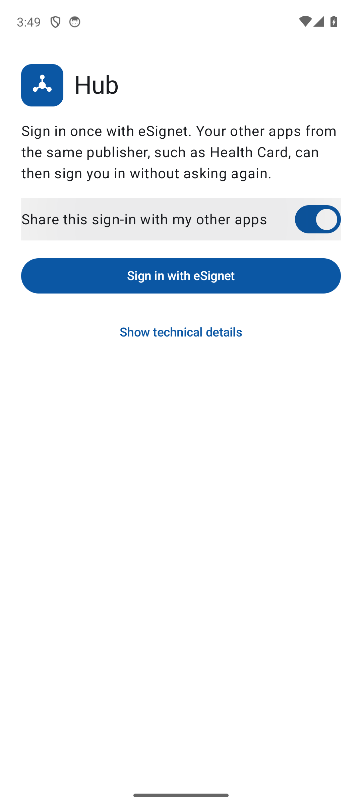 |  | 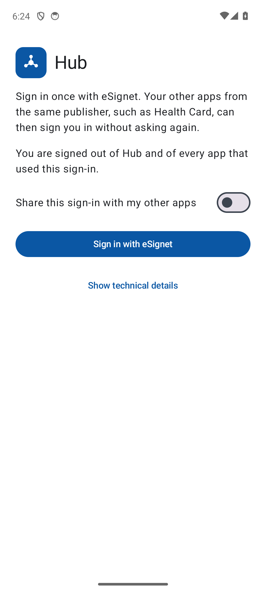 |

| Health Card: signed in by Hub, no browser | Health Card: re-consent screen | Health Card: after the extra permission |
|---|---|---|
|  | 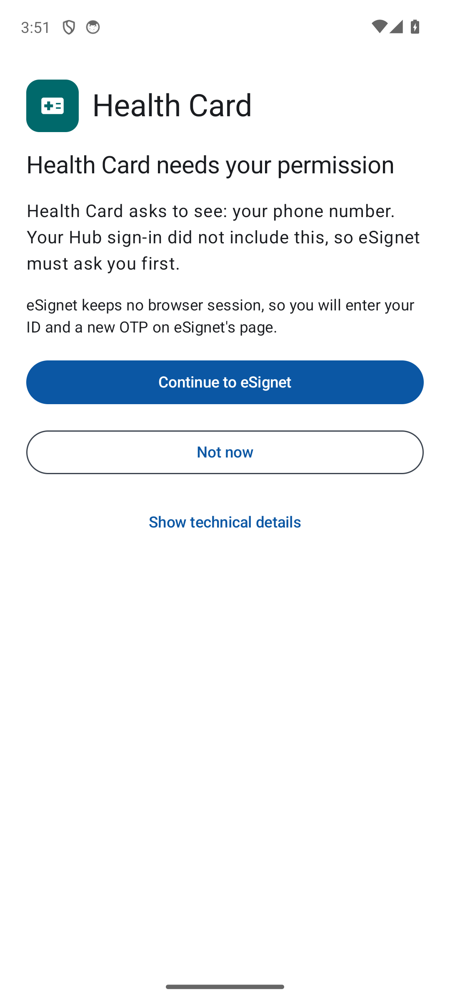 | 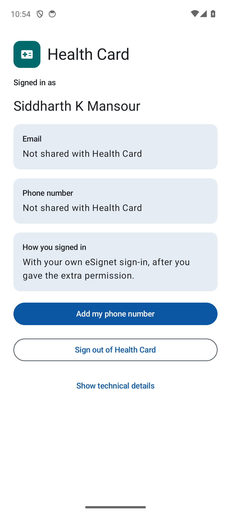 |

| Health Card: signed out of Health Card only | Health Card: Hub signed out, or sharing off | Health Card: Hub not installed |
|---|---|---|
| 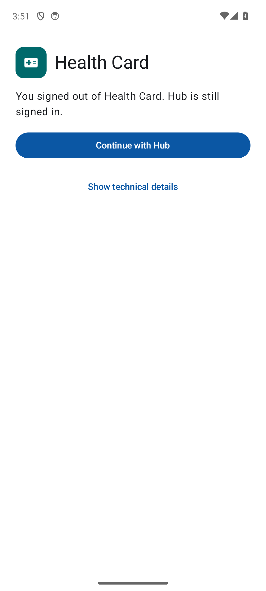 | 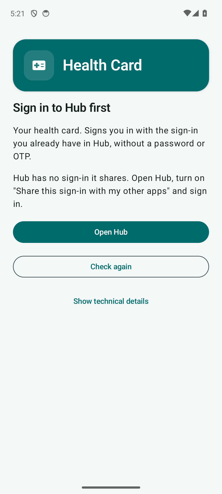 | 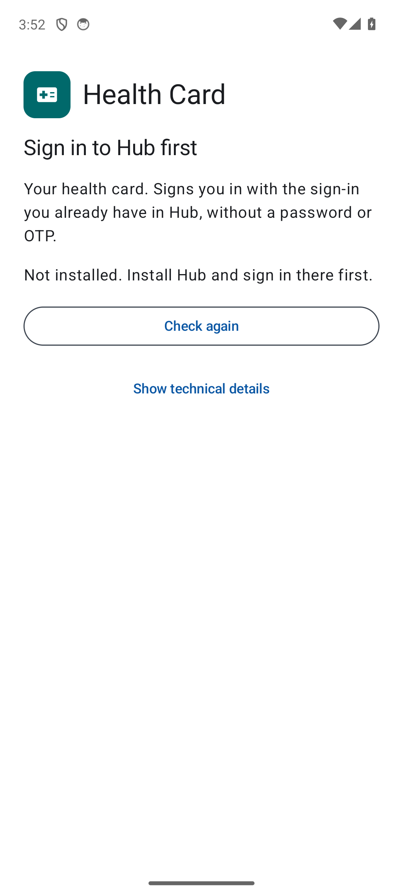 |

| Health Card: "Not now" on the consent screen | Health Card: "Not now" on eSignet's consent page | eSignet's login page (Health Card's re-consent login, in Chrome) |
|---|---|---|
| 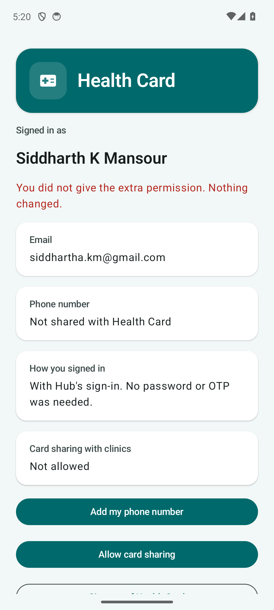 | 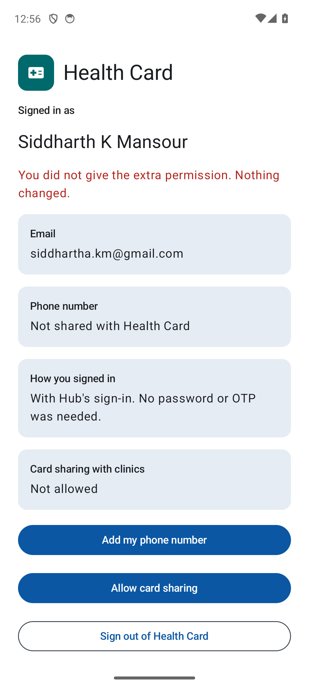 | 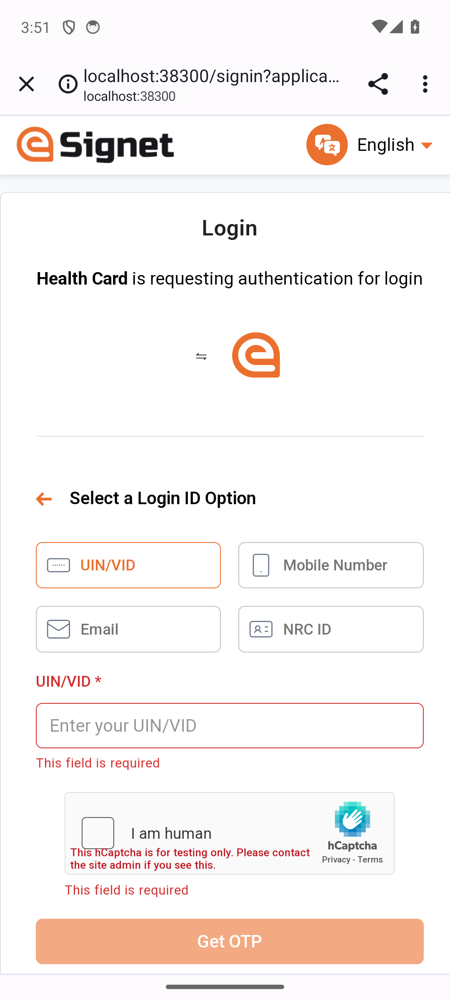 |

| Health Card: permission that needs no login | eSignet's consent page (no ID, no OTP) | Health Card: card sharing allowed |
|---|---|---|
| 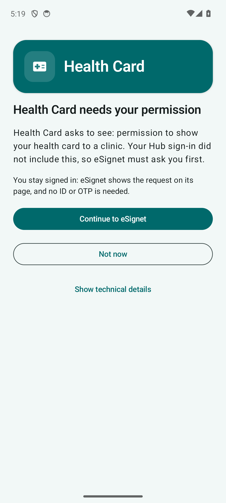 |  | 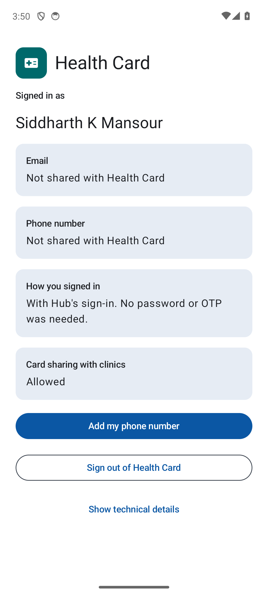 |

- Test that takes each screenshot: `SuperAppSignInTest` (the two Hub screens before sign-out),
  `ChildAppSilentSignInTest`, `ChildAppConsentOnlyTest` (the consent-only screens and the refusal on eSignet's
  page), `ChildAppReconsentTest`
  (consent screen, "Not now", eSignet's login page, after the extra permission), `ChildAppSignOutTest` (the three sign-out screens) and
  `ChildAppHubMissingTest` (Hub not installed), all from the UI test run of 2026-10-06 that ended at 19:34 IST at
  `ef69358` (`run-ui-test.sh all`: `OK (6 tests)`); eSignet's login page and the refusal on eSignet's page come from the run of 2026-10-14.
- "Hub signed out" and "sharing switched off in Hub" are one screen for Health Card: in both cases Hub's service
  has no sign-in to share (`FamilySsoGate.bundle` returns nothing), so Health Card shows the text "Hub has no
  sign-in it shares. Open Hub, turn on "Share this sign-in with my other apps" and sign in."
- When Hub is not installed, Health Card says "Not installed. Install Hub and sign in there first." and hides the
  "Open Hub" button. After "Not now" on the consent screen, Health Card returns to its home screen, still signed in
  with Hub, with "You did not give the extra permission. Nothing changed."
- Both apps have their own launcher icon in the same style: Hub blue with a "one sign-in, many apps" mark, Health
  Card teal with a card and a health cross. The same mark heads every screen, next to the app name.

## Flows

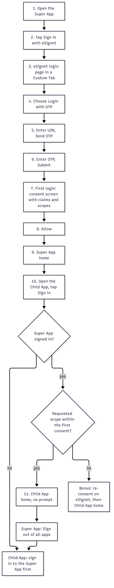

| Flow | Steps the user sees | Diagram |
|---|---|---|
| First sign-in in Hub | Hub (signed out) -> switch "Share this sign-in with my other apps" -> "Sign in with eSignet" -> browser: UIN, OTP, consent (optional email switch, off at first) -> back in Hub, signed in | [seq-super-app-login](diagrams/seq-super-app-login.png) |
| Health Card, silent | open Health Card -> "Signing you in with Hub..." -> home with the name and the email (optional in Hub's login); no browser | [seq-child-app-sso](diagrams/seq-child-app-sso.png) |
| Health Card, Hub not signed in | "Sign in to Hub first" with "Open Hub"; after Hub signs in, Health Card signs in on resume | same |
| Re-consent, no login (permission) | "Allow card sharing" -> explainer ("no ID or OTP is needed") -> "Continue to eSignet" -> eSignet's page "Allow more access?" -> "Allow" -> back in Health Card, still signed in with Hub, "Card sharing with clinics: Allowed" | [seq-consent-only](diagrams/seq-consent-only.png) |
| Re-consent, no login, declined | same, then "Not now" on eSignet's page -> home again with "You did not give the extra permission. Nothing changed." | same |
| Re-consent with login (new user data) | "Add my phone number" -> explainer (OTP asked again) -> "Continue to eSignet" -> browser login -> phone number shown | [seq-reconsent](diagrams/seq-reconsent.png) |
| Re-consent declined | "Add my phone number" -> explainer -> "Not now" -> home again, still signed in with Hub, with "You did not give the extra permission. Nothing changed." | [seq-reconsent](diagrams/seq-reconsent.png) |
| Sign out of Health Card | "Sign out of Health Card" -> "You signed out of Health Card. Hub is still signed in." -> "Continue with Hub" | - |
| Sign out of all apps | Hub "Sign out of all apps" -> "You are signed out of Hub and of every app that used this sign-in."; Hub also asks eSignet to end the device secret's session; Health Card clears itself on its next resume | [seq-child-app-sso](diagrams/seq-child-app-sso.png) |

## Screens in words

### Hub

```
Signed out                              Signed in
+---------------------------------+     +---------------------------------+
| [mark] Hub                      |     | [mark] Hub                      |
| Sign in once with eSignet. Your |     | Signed in as                    |
| other apps from the same        |     |   <name>                        |
| publisher, such as Health Card, |     | Sign-in shared with my other    |
| can then sign you in without    |     | apps: Yes, until 18:42          |
| asking again.                   |     | Apps using this sign-in         |
| [ ] Share this sign-in with my  |     |   Health Card, last used 10:42  |
|     other apps                  |     | [ Sign out of all apps ]        |
| [ Sign in with eSignet ]        |     | Show technical details          |
| Show technical details          |     +---------------------------------+
+---------------------------------+
Working: "Signing you in..." / "Finish signing in on eSignet's page in the browser."  [ Cancel ]
After the 8 hours of the device secret: "Ended at 18:42. Sign out and sign in again to share it."
After sign-out: "You are signed out of Hub and of every app that used this sign-in."
Errors: network, server refused (with its error code), failed security check, expired, wrong sign-in, unexpected
```

### Health Card

```
Hub first                  Consent                         Home
+--------------------+     +----------------------------+  +----------------------------+
| [mark] Health Card |     | [mark] Health Card         |  | [mark] Health Card         |
| Sign in to Hub     |     | Health Card needs your     |  | Signed in as <name>        |
| first              |     | permission                 |  | Email  <email>             |
| <reason>           |     | Health Card asks to see:   |  | Phone number               |
| Your health card.  |     | your phone number. Your    |  |   Not shared with Health   |
| Signs you in with  |     | Hub sign-in did not        |  |   Card   [Add my phone     |
| the sign-in you    |     | include this, so eSignet   |  |   number]                  |
| already have in    |     | must ask you first.        |  | How you signed in          |
| Hub ...            |     | eSignet keeps no browser   |  |   With Hub's sign-in. No   |
| [ Open Hub ]       |     | session, so you will enter |  |   password or OTP needed.  |
| [ Check again ]    |     | your ID and a new OTP.     |  | [ Sign out of Health Card ]|
+--------------------+     | [ Continue to eSignet ]    |  +----------------------------+
                           | [ Not now ]                |
                           +----------------------------+
Signed out of Health Card: "You signed out of Health Card. Hub is still signed in." [ Continue with Hub ]
```

- Each Hub failure has its own text on the Health Card screen: not installed, signed with another certificate,
  no answer in time, busy, version mismatch, Hub signed out ("Your Hub sign-in has ended. Open Hub and sign in again").
- Every error screen says what happened in plain words and offers one action ("Try again", "Open Hub").
- No screen shows a package name, a server address, a certificate or the words "Super App" or "Child App". Those
  details sit behind "Show technical details" at the bottom of every screen, folded by default: Hub shows the
  eSignet server and its client ID, Health Card the eSignet server, its signing certificate and whether Hub carries
  the same one. `HubScreensTest` and `CardScreensTest` check that nothing of this shows until the user opens it.
- Release builds write nothing to the Android log; debug builds log the steps (never a token) for the UI tests.

## Design decisions

- Both apps share one layout and one colour palette: the app mark and name at the top, then what is happening,
  then what the user can do, then the folded technical details. Only the mark's colour tells them apart.
- The re-consent screen tells the user before the browser opens whether a new OTP will be asked. A permission that
  needs no new user data is approved on eSignet's own page with one tap and no login; only new user data (the phone
  number) needs the ID and a new OTP, because eSignet's identity system releases user data only after an
  authentication (limit L02).
- eSignet's consent page is the server's own page, not Health Card's: the app cannot claim the user said yes. It
  names both apps, uses the same 48 dp buttons and a readable font size, and needs no script. It looks like eSignet's
  login pages (oidc-ui): a white header with the eSignet mark and name, a white card on a pale background, a centred
  title and a full-width primary button. The buttons use a darker shade of eSignet's orange (`#b84e17` instead of
  `#eb6f2d`) so that white text keeps a 5:1 contrast (WCAG 2.2, 1.4.3); the mark keeps the brand colour. The mark is
  drawn inline because the page's Content-Security-Policy loads nothing from elsewhere.
- The consent page shows each permission with a plain-language text from the setting `oauth.native_sso.consent_scope_descriptions` in `deployment.yaml` (or the env var `MOSIP_ESIGNET_NATIVE_SSO_CONSENT_SCOPE_DESCRIPTIONS`, a JSON object of scope to text), with the scope value in small type behind it. `health_card_share` reads "Share your health card with clinics". A scope with no entry is shown by its raw value, as before. See [the page](screens/esignet-consent-only-page.png).
- The switch "Share this sign-in with my other apps" is off by default in Hub (the user opts in) and decides whether the `device_sso` scope is
  requested at all; with it off Hub behaves as an ordinary sign-in app and Health Card shows the Hub-first state.
- Hub lists the apps that used its sign-in by the name the launcher shows, with the time of last use, never a token
  or a package name ("Apps using this sign-in"). An app Android does not let Hub see is listed as "An app from the
  same publisher".
- Sign-out is one action in Hub. It ends Hub's sign-in on the phone at once, then asks eSignet to end the device
  secret's session (rule R27); Health Card follows without a network call by noticing, on every resume, that Hub's
  sign-in is gone.

## Accessibility

Done in WP-15 on the screens of both apps. Checked in two places: JVM screen tests in each app (`HubScreensTest`,
`CardScreensTest`, Robolectric, at 200 % font size on a small phone, 360 x 640 dp), and, since 2026-10-21, an automated
accessibility scan on the emulator during the UI tests.

| Aspect | What was done | Check |
|---|---|---|
| Labels and reading order | headings are marked; each labelled value is one TalkBack item; the reading order follows the visual order | `HubScreensTest`, `CardScreensTest`; emulator scan (label present, reading order) |
| Every control named | every clickable item has a text or a content description | `HubScreensTest`, `CardScreensTest` (every screen they show); emulator scan |
| Touch targets | 48 dp touch targets on every control of both apps | `HubScreensTest`, `CardScreensTest` (every clickable item at least 48 x 48 dp); emulator scan |
| Colour contrast | every text and background pair is at least 4.5 to 1, in light and dark | `HubThemeTest`, `CardThemeTest` |
| Large text | every screen of both apps keeps its actions reachable at 200 % font scale | `HubScreensTest`, `CardScreensTest` |
| Status changes | status and error text is a polite live region, so it is spoken when it changes | `HubScreensTest`, `CardScreensTest` ("is spoken") |
| No colour-only meaning | states carry words ("Yes", "No", "Not shared with Health Card") | strings |
| Decorative images | the app mark next to the name has no description, so TalkBack reads the name once | code (`Header()` in both `MainActivity.kt`) |

### Automated accessibility scan on the emulator (2026-10-21)

- Tool: Google's Accessibility Test Framework for Android 4.1.1
  (`com.google.android.apps.common.testing.accessibility.framework`), the library behind Espresso's
  `AccessibilityChecks` and the Accessibility Scanner app, with its newest rule set (`AccessibilityCheckPreset.LATEST`,
  13 checks: touch target size, speakable text, duplicate clickable bounds, duplicate speakable text, redundant
  descriptions, editable labels, clickable spans, link purpose, text and image contrast, text size, traversal order and
  others).
- How: [`android/ui-test-support/AccessibilityScan.kt`](../android/ui-test-support/AccessibilityScan.kt) reads the
  window in front the way TalkBack does (`UiAutomation.getRootInActiveWindow()`), adds a screenshot for the contrast
  checks, and runs every check. The UI tests call it on every screen of Hub and Health Card that they photograph, so
  each screenshot above is also a checked screen. Any result of type ERROR fails the test; warnings are written down.
  Chrome windows (eSignet's login and consent pages) are skipped, because the browser's own interface is not ours.
- Findings per screen: `$PS03_RUN_DIR/evidence/ui-<app>-<time>/ui-test/a11y/<screen>.txt` and log tag `PS03A11y`.
- Result: `bash scripts/with-stack.sh bash android/scripts/with-emulator.sh bash android/scripts/run-ui-test.sh all`
  on 2026-10-21 (ended 13:52 IST, AVD `ps03_api34`, API 34): `OK (6 tests)`, 13 screens checked (Hub: 3, Health Card: 10), 0 errors,
  0 warnings on every screen. Nothing in the apps had to change.
- The scan was checked against a known fault: an unlabelled 20 dp clickable box added to Health Card's "Hub not
  installed" screen for one run made `ChildAppHubMissingTest` fail with `SpeakableTextPresentCheck` ("This item may
  not have a label readable by screen readers"); the same box made `CardScreensTest` fail on its size. The box was
  removed again.
- Limits of the scan on Compose screens: the framework cannot read the text colour of Compose text (it reports
  "text color could not be determined", so the text contrast check does not run there; `HubThemeTest` and
  `CardThemeTest` cover contrast). Compose reports the touch area of a control, which it widens to 48 dp, not its
  drawn size; the JVM screen tests check the drawn size.

A team member did a TalkBack walk-through and a large-font pass on a OnePlus CPH2569 on 2026-10-24 (item M02, steps MT30 to
MT33 of [manual-test-checklist.md](manual-test-checklist.md)); the tester reported no issues and no per-item notes exist
([phone-run.md](evidence/2026-10-24/phone-run.md)). The automated checks find missing labels, small targets and order
problems; they do not judge whether what TalkBack says makes sense to a listener.
